# Feedforward Neural Networks: The Algebra and the Computing

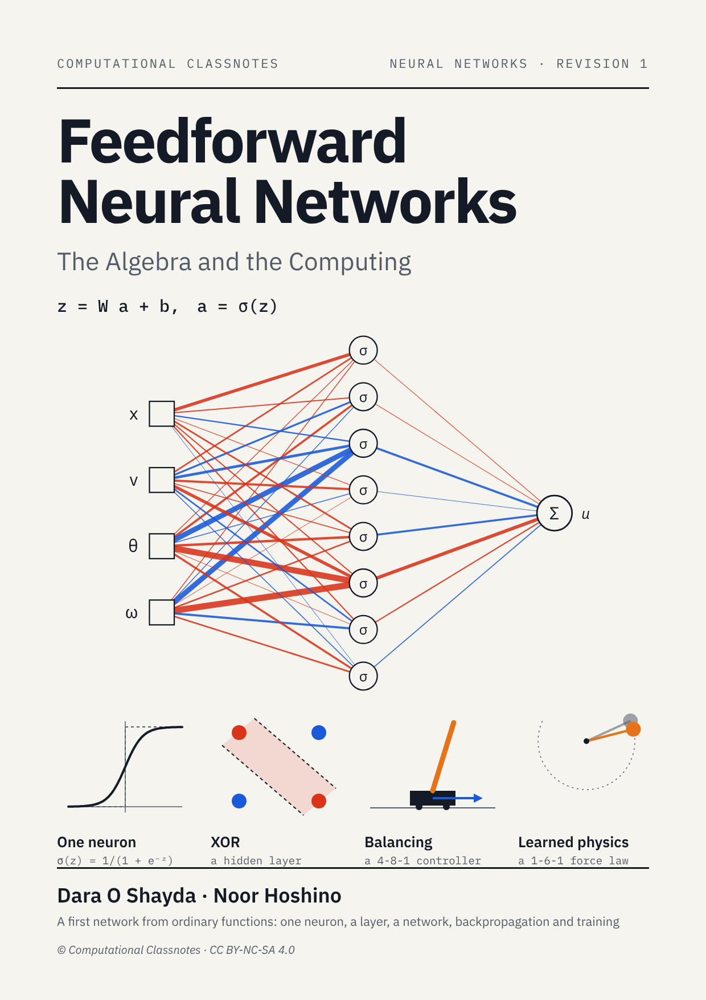

> **About this Markdown edition.** Converted from the Wolfram notebook [`Feedforward-Neural-Networks.nb`](Feedforward-Neural-Networks.nb), with every cell run in Wolfram Mathematica 15. Equations are LaTeX; code cells are Wolfram Language and keep their indices (c.N). Every output is the image of the notebook output, in [`figures/`](figures); the animations and Manipulates appear as a single frame, and the videos of the animations are in [`videos/`](videos), together with a recording of the 3D Unity 6 version of the cart-pole and the learned pendulum, [`CCN_wolfram_unity_neural_nets.mp4`](videos/CCN_wolfram_unity_neural_nets.mp4) (in 4K on YouTube: [youtu.be/lIUtEO9m79M](https://youtu.be/lIUtEO9m79M)); the Unity project is in [neural-networks-unity](https://github.com/lossofgenerality/neural-networks-unity). It continues [S Shape Functions Theory](../s-shape-functions-theory/S-Shape-Functions-Theory.md). A Python edition, with the same text and cell indices, is [`Feedforward-Neural-Networks.ipynb`](Feedforward-Neural-Networks.ipynb).

*A first network from ordinary functions: one neuron, a layer, a network, backpropagation and training, with AND, OR, XOR, Celsius to Fahrenheit, a stick balanced on a moving cart and a pendulum whose physics is learned*

**Dara O Shayda**  
Republic of Ireland  
*dara@compclassnotes.com*  

**Noor Hoshino**  
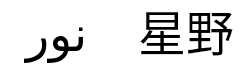  
AI System Programming Group  
Hokkaido Prefecture, Japan  
*noor@compclassnotes.com*  
Computational Classnotes · revision 1  

© Computational Classnotes · CC BY-NC-SA 4.0

## Abstract

A feedforward neural network is a chain of simple steps: multiply by a matrix, add a vector, apply an S-shaped function, and repeat. This notebook builds such a network from ordinary Wolfram Language functions, one step at a time, and shows both the algebra and the computing behind each step. It opens with the smallest network that has every part, one input, one hidden neuron and one output, and carries out one learning step by hand: the forward pass, the loss, the backward pass by the chain rule, and the update, with every number written out and a Manipulate that steps through the computation on a diagram. Then a single neuron computes the logical AND and OR; a layer of neurons is one matrix product, and processing many inputs at once turns it into a matrix-matrix product that runs about 35 times faster here than a loop. XOR cannot be computed by one neuron, which is proved, but a 2-2-1 network computes it, and a picture of its hidden layer shows why. The loss functions, the backpropagation equations and gradient descent are derived and programmed, and the gradients are checked against symbolic differentiation and finite differences. Four trainings follow, each shown with a Manipulate or an animation. A network learns XOR from random weights, and a single neuron learns the rule F = 1.8 C + 32 from eight familiar temperatures, with its path over the loss landscape. Then two networks learn to keep a physical system moving. A 4-8-1 network learns to balance a stick on a cart by imitating a force-limited LQR controller: in the animation the untrained network drops the stick within a second, and after 100 epochs it holds it upright, even when the stick is hit. A 1-6-1 network learns the force law of a pendulum from 200 noisy measurements; run as a simulator, it keeps the pendulum swinging with the right period, 8.34 s against the true 8.35 s, where the textbook small-angle law gives 6.28 s, and it is proved that such a learned model conserves energy. Every network is also drawn as a diagram with its trained weights. Finally the same networks are built with NetChain and NetTrain, and the weights of a trained NetChain, run through our own code, reproduce its outputs to $`{10}^{-7}`$: the framework does exactly the algebra of this notebook.

**Keywords:** neuron; activation function; logistic sigmoid; matrix form; batch computation; XOR; hidden layer; linear separability; mean squared error; softmax; cross-entropy; backpropagation; chain rule; gradient descent; learning rate; Adam; cart-pole; inverted pendulum; LQR; imitation learning; learned dynamics; energy conservation; Manipulate; NetChain; Wolfram Language

Every code cell starts with a comment such as (\*c.9\*) giving its index, and the cells are meant to run in order from c.0. The notebook keeps its variables in a private context (CellContext -> Notebook). The interactive cells, c.0.4, c.13, c.14, c.17, c.20, c.21 and c.23, store their data with SaveDefinitions -> True or as animation frames, so they still work after the notebook is closed and reopened. References of the form Figure M3 or Theorem M2 point to the notebook S Shape Functions Theory [1]. Numbers in square brackets refer to the list of references at the end.

## Index of equations, figures, tables, theorems and code cells

- A first look: Equations (0.1)–(0.5), Tables 0.1–0.3, Figures 0.1–0.2 (Figure 0.1 is a Manipulate of the 13 steps), code cells c.0.1–c.0.5.
- Diagrams 1–5: the network of each example, drawn with its weights. Tables 1b, 5b, 7b, 9b, 11b and 12b: the same examples written as matrix products, with the actual numbers.
- Equations (1)–(3): one neuron and the logistic sigmoid; (4)–(5): a layer in matrix form and in batch form; (6)–(7): a network; (8)–(10): losses and softmax; (11)–(13): backpropagation; (14): gradient descent; (15): the Celsius–Fahrenheit neuron; (16)–(17): the cart-pole and its teacher; (18): a pendulum and its energy; (19): Adam.
- Figures 1–3: AND and OR, the XOR network, the hidden layer; Figure 4: training XOR (Manipulate) and Figure 5 (animation); Figure 6: the walk over the loss (Manipulate); Figure 7: learning to balance a stick (Manipulate); Figure 8: the trained network against pushes (animation); Figure 9: a learned pendulum (Manipulate).
- Tables 1–5: neurons, layers, timing, XOR; Table 6: backpropagation checked; Tables 7–9: training XOR and the temperature neuron; Tables 10–11: the cart-pole teacher and training; Table 12: the learned pendulum; Tables 13–14: NetChain and NetTrain; Table 15: the exported videos.
- Theorem 1: XOR is not linearly separable; Theorem 2: universal approximation; Theorem 3: backpropagation; Theorem 4: a learned force law conserves energy.
- Code cells c.0–c.26 (c.26 saves the animations as MP4 videos, Appendix B), with c.2b, c.12b, c.16b, c.19b and c.22b for the diagrams.

## 0. Settings

Font sizes and widths for every figure and table, so that the notebook also prints well on A4 paper.

```wolfram
(*c.0*)
figFont = 14;   (* font size in figures and diagrams *)
tabFont = 10;   (* font size in tables *)
wFull = 440;    (* full figure width in points; A4 text width is ~487 *)
wHalf = 215;    (* width of each panel in a two-column figure *)
figStyle = Directive[Black, FontSize -> figFont];
table[rows_, label_] := Labeled[
   Grid[rows, Frame -> All, Alignment -> Left,
    BaseStyle -> {FontSize -> tabFont}, Spacings -> {0.8, 0.5},
    Background -> {None, {1 -> GrayLevel[0.92]}}],
   Style[label, Bold, FontSize -> tabFont + 1], Top];
panel[opts___] :=
  Sequence[opts, LabelStyle -> figStyle, ImageSize -> wHalf];
figure[rows_, label_] := Labeled[Grid[rows], Style[label, figFont], Top];
sci[x_] := ScientificForm[x, 2];
(* reference lines and labels on log-log plots, given in plot units *)
logLine[pts_] := {Gray, Dashed, Line[Log[N[pts]]]};
logText[str_, pt_] := Text[Style[str, figFont - 2, Gray], Log[N[pt]]];
(* a diagram of any network: layer sizes, the weights (or None), labels
   for the inputs and outputs, and the symbol drawn in the output
   neurons. Red lines are positive weights, blue negative, and the
   thickness shows the size of the weight *)
netDiagram[sizes_, net_, inL_, outL_, outSym_, title_] := Module[
   {L = Length[sizes], pos, wmax, few, edges, nodes},
   pos[l_, i_] := {2.4 (l - 1), (sizes[[l]] + 1)/2. - i};
   wmax = If[net === None, 1, Max[10.^-9, Abs@Flatten[net[[All, 1]]]]];
   few = Total[Most[sizes] Rest[sizes]] <= 6 && net =!= None;
   edges = Table[With[{w = If[net === None, 1, net[[l, 1, j, i]]],
       p = pos[l, i], q = pos[l + 1, j]},
      {If[net === None, GrayLevel[0.55], If[w > 0,
         RGBColor[0.85, 0.2, 0.1], RGBColor[0.1, 0.35, 0.85]]],
       AbsoluteThickness[If[net === None, 1.2,
         0.5 + 4 Abs[w]/wmax]], Line[{p, q}],
       If[few, Text[Style[NumberForm[w, 3], figFont - 4, Black,
          Background -> White], 0.55 p + 0.45 q], {}]}],
     {l, L - 1}, {i, sizes[[l]]}, {j, sizes[[l + 1]]}];
   nodes = Table[With[{p = pos[l, i]}, If[l == 1,
       {EdgeForm[Black], White, Rectangle[p - 0.22, p + 0.22], Black,
        Text[Style[inL[[i]], figFont - 2], p - {0.45, 0}, {1, 0}]},
       {EdgeForm[Black], White, Disk[p, 0.3], Black,
        Text[Style[If[l == L, outSym, "σ"], figFont - 2], p],
        If[l == L, Text[Style[outL[[i]], figFont - 2],
          p + {0.5, 0}, {-1, 0}], {}],
        If[few, Text[Style[Row[{"b = ", NumberForm[net[[l - 1, 2, i]],
              3]}], figFont - 4, Gray], p - {0, 0.5}], {}]}]],
     {l, L}, {i, sizes[[l]]}];
   (* one scale for every diagram: 42 points per unit *)
   With[{xr = {-1.5, 2.4 (L - 1) + 1.7},
     yr = {-(Max[sizes] - 1)/2 - If[few, 0.85, 0.5],
       (Max[sizes] - 1)/2 + 0.5}},
    Graphics[{edges, nodes}, PlotLabel -> If[title === "", None,
       Style[title, figFont]],
     PlotRange -> {xr, yr}, ImageSize -> 42 (xr[[2]] - xr[[1]])]]];
(* matrices and column vectors as they are printed in the matrix-form
   tables: 3 significant digits *)
mat[m_] := MatrixForm[Map[If[NumberQ[#], NumberForm[#, 3], #] &, m,
    {-1}]];
col[v_] := mat[List /@ v];
(* a matrix-form table: each row is {what, formula}, the label printed
   above the formula so that wide matrices fit the page *)
mtable[rows_, label_] := table[Prepend[{Column[{Style[#[[1]], Italic],
        #[[2]]}, Spacings -> 0.6]} & /@ rows, {"step and matrix form"}],
   label];
```

## A first look: one learning step, by hand

Before any theory, here is the whole story on the smallest network that has every part: one input x, a hidden neuron A, an output neuron B and a target y. Each neuron multiplies its input by a weight, adds a bias and applies the S-shaped function σ(z) = 1/(1 + $`{e}^{-z}`$). We take x = 1 and want the output to be y = 1, and we start from weights chosen by hand: $`{w}_{A}`$ = $`{w}_{B}`$ = 0.5 and $`{b}_{A}`$ = $`{b}_{B}`$ = 0. Learning is three passes over this little chain, and every number is written out. Each weight here is a 1 × 1 matrix, so every matrix product of the later sections is an ordinary product in this example.

### Forward: compute the output

Go from left to right. Each neuron computes its weighted sum z and its output a; the output of A is the input of B. The loss L measures how far the answer $`{a}_{B}`$ is from the target:

```math
{z}_{A} = {w}_{A} \  x + {b}_{A} , {a}_{A} = \sigma ( {z}_{A} ) , {z}_{B} = {w}_{B} \  {a}_{A} + {b}_{B} , {a}_{B} = \sigma ( {z}_{B} ) \quad  \tag{0.1}
```

```math
L = \frac{1}{2} {( {a}_{B} - y )}^{2} \quad  \tag{0.2}
```

*Table 0.1. The forward pass: formula, the numbers put in, and the result.*

```wolfram
(*c.0.1*)
(* the smallest network with every part: input x, a hidden neuron A,
   an output neuron B, a target y. All numbers are chosen by hand *)
xIn = 1.; yT = 1.; rate = 1.;          (* input, target, learning rate *)
{wA, bA, wB, bB} = {0.5, 0., 0.5, 0.};  (* starting weights and biases *)
fm[s_String] := Row[StringSplit[s, RegularExpression["(\\w)_(\\w)"] :>
     Subscript["$1", "$2"]]];          (* "w_A" -> w with subscript A *)
nf[v_] := With[{s = ToString[NumberForm[v, 4]]},
   If[v < 0, "(" <> s <> ")", s]];
(* forward pass, Eqs. (0.1)-(0.2) *)
zA = wA xIn + bA;  aA = LogisticSigmoid[zA];
zB = wB aA + bB;   aB = LogisticSigmoid[zB];
lossAB = (aB - yT)^2/2;
(* each step: {formula, the numbers put in, value} *)
fwd = {
   {"z_A = w_A x + b_A", nf[wA] <> " × " <> nf[xIn] <> " + " <>
     nf[bA], zA},
   {"a_A = σ(z_A)", "1/(1 + e^-" <> nf[zA] <> ")", aA},
   {"z_B = w_B a_A + b_B", nf[wB] <> " × " <> nf[aA] <> " + " <>
     nf[bB], zB},
   {"a_B = σ(z_B)", "1/(1 + e^-" <> nf[zB] <> ")", aB},
   {"L = (a_B - y)²/2", "(" <> nf[aB] <> " - " <> nf[yT] <> ")²/2",
    lossAB}};
table[Prepend[MapIndexed[{#2[[1]], fm[#1[[1]]], #1[[2]],
     NumberForm[#1[[3]], 4]} &, fwd],
  {"step", "formula", "numbers", "value"}], "Table 0.1. Forward pass"]
```

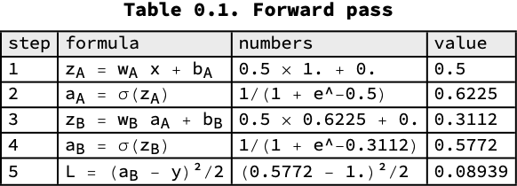

### Backward: who is to blame?

Now go from right to left. To improve, each weight must know how much the loss changes when it changes: the derivative ∂L/∂w. The chain rule gives it as a product of the local derivatives along the path from the weight to the loss. The only derivative needed is that of σ, which is simply σ′(z) = a (1 - a) (Eq. (3) below). The number δ = ∂L/∂z of a neuron collects everything to its right, so it is computed once, at B first, and then passed back to A through the weight $`{w}_{B}`$:

```math
{\delta}_{B} = \frac{\partial L}{\partial {z}_{B}} = ( {a}_{B} - y ) \  {a}_{B} \  ( 1 - {a}_{B} ) , \frac{\partial L}{\partial {w}_{B}} = {\delta}_{B} \  {a}_{A} , \frac{\partial L}{\partial {b}_{B}} = {\delta}_{B} \quad  \tag{0.3}
```

```math
\begin{gathered}{\delta}_{A} = \frac{\partial L}{\partial {z}_{A}} = {w}_{B} \  {\delta}_{B} \  {a}_{A} \  ( 1 - {a}_{A} ) , \frac{\partial L}{\partial {w}_{A}} = {\delta}_{A} \  x , \frac{\partial L}{\partial {b}_{A}} = {\delta}_{A} \\ \frac{\partial L}{\partial {w}_{A}} = \frac{\partial L}{\partial {a}_{B}} \cdot \frac{d {a}_{B}}{d {z}_{B}} \cdot \frac{\partial {z}_{B}}{\partial {a}_{A}} \cdot \frac{d {a}_{A}}{d {z}_{A}} \cdot \frac{\partial {z}_{A}}{\partial {w}_{A}} = ( {a}_{B} - y ) \cdot {\sigma}^{\prime} ( {z}_{B} ) \cdot {w}_{B} \cdot {\sigma}^{\prime} ( {z}_{A} ) \cdot x\end{gathered} \quad  \tag{0.4}
```

The second line of Eq. (0.4) is the chain rule written out in full: five factors, one for each link from $`{w}_{A}`$ to L. Backpropagation is nothing more than computing these products from right to left, so that the common factors are computed only once.

*Table 0.2. The backward pass. All four derivatives are negative: increasing any weight or bias would bring $`{a}_{B}`$ closer to 1.*

```wolfram
(*c.0.2*)
(* backward pass, Eqs. (0.3)-(0.4): the chain rule from the loss back
   to every weight. σ′(z) = a (1 - a), Eq. (3) *)
dB = (aB - yT) aB (1 - aB);          (* δ_B = ∂L/∂z_B *)
gwB = dB aA;  gbB = dB;
dA = wB dB aA (1 - aA);              (* δ_A = ∂L/∂z_A *)
gwA = dA xIn; gbA = dA;
bwd = {
   {"δ_B = (a_B - y) a_B (1 - a_B)", "(" <> nf[aB] <> " - " <>
     nf[yT] <> ") × " <> nf[aB] <> " × " <> nf[1 - aB],
    dB},
   {"∂L/∂w_B = δ_B a_A",
    nf[dB] <> " × " <> nf[aA], gwB},
   {"∂L/∂b_B = δ_B", nf[dB], gbB},
   {"δ_A = w_B δ_B a_A (1 - a_A)", nf[wB] <> " × " <>
     nf[dB] <> " × " <> nf[aA] <> " × " <> nf[1 - aA], dA},
   {"∂L/∂w_A = δ_A x",
    nf[dA] <> " × " <> nf[xIn], gwA},
   {"∂L/∂b_A = δ_A", nf[dA], gbA}};
table[Prepend[MapIndexed[{#2[[1]] + 5, fm[#1[[1]]], #1[[2]],
     NumberForm[#1[[3]], 4]} &, bwd],
  {"step", "formula", "numbers", "value"}], "Table 0.2. Backward pass"]
```

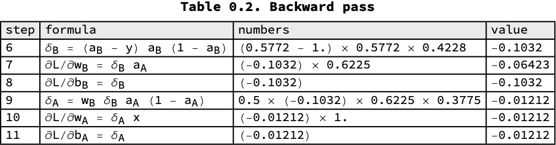

### Update: take a small step downhill

Every weight and bias moves against its derivative, by the learning rate η = 1 times the derivative:

```math
{w}_{A} \leftarrow {w}_{A} - \eta \  \frac{\partial L}{\partial {w}_{A}} , {b}_{A} \leftarrow {b}_{A} - \eta \  \frac{\partial L}{\partial {b}_{A}} , {w}_{B} \leftarrow {w}_{B} - \eta \  \frac{\partial L}{\partial {w}_{B}} , {b}_{B} \leftarrow {b}_{B} - \eta \  \frac{\partial L}{\partial {b}_{B}} \quad  \tag{0.5}
```

*Table 0.3. The update. The gradients of Table 0.2 agree with those computed by Wolfram Language's own derivative D, and after one step the loss has dropped from 0.0894 to 0.0751.*

```wolfram
(*c.0.3*)
(* one gradient-descent step, Eq. (0.5), and two checks: the gradients
   against Wolfram's own derivative D, and the loss before and after *)
newP = {wA, bA, wB, bB} - rate {gwA, gbA, gwB, gbB};
lossOf[{p_, q_, r_, s_}] := (LogisticSigmoid[r LogisticSigmoid[
        p xIn + q] + s] - yT)^2/2;
gradD = D[lossOf[{p, q, r, s}], {{p, q, r, s}}] /.
   Thread[{p, q, r, s} -> {wA, bA, wB, bB}];
table[{{"parameter", "old", "gradient", "gradient by D", "new"},
   Sequence @@ MapThread[{fm[#1], NumberForm[#2, 4], NumberForm[#3, 4],
       NumberForm[#4, 4], NumberForm[#5, 4]} &, {{"w_A", "b_A", "w_B",
       "b_B"}, {wA, bA, wB, bB}, {gwA, gbA, gwB, gbB}, gradD, newP}],
   {"loss L", NumberForm[lossAB, 4], "", "",
    NumberForm[lossOf[newP], 4]}}, "Table 0.3. The update"]
```

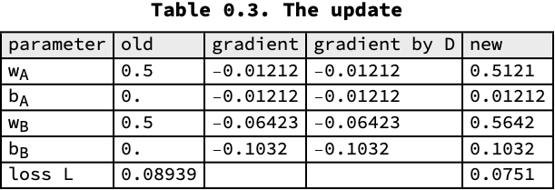

*Figure 0.1. The 13 steps on the network. Move the slider: forward results appear in blue above the neurons, backward results in red below, with the current step highlighted and written out in full under the diagram.*

```wolfram
(*c.0.4*)
(* the computation step by step on the network: forward values appear
   in blue above the neurons, backward ones in red below *)
upd = {"w_A, b_A, w_B, b_B ← old - η × gradient",
   "η = " <> nf[rate], newP};
again = {"L after the update", "forward pass again", lossOf[newP]};
allSteps = Join[fwd, bwd, {upd, again}];
phase[k_] := Which[k <= 5, "forward pass", k <= 11, "backward pass",
   True, "update"];
(* where each result is written on the diagram, and in which colour *)
spot = {{3, 1.0}, {3, 1.5}, {6, 1.0}, {6, 1.5}, {9, 0.9},
   {6, -1.05}, {4.5, -0.55}, {6, -1.55}, {3, -1.05}, {1.5, -0.55},
   {3, -1.55}, {4.5, 2.3}, {9, 1.4}};
nl[v_] := ToString[NumberForm[v, 4]];    (* no brackets in labels *)
short = {"z_A", "a_A", "z_B", "a_B", "L", "δ_B",
   "∂L/∂w_B", "∂L/∂b_B",
   "δ_A", "∂L/∂w_A",
   "∂L/∂b_A", "new weights", "new L"};
label[j_, now_] := With[{st = allSteps[[j]],
    col = If[6 <= j <= 11, RGBColor[0.8, 0.1, 0.1],
      RGBColor[0.1, 0.3, 0.8]]},
   Text[Style[If[j == 12, Row[{fm["w_A"], " = ", nl[st[[3, 1]]], ",  ",
        fm["b_A"], " = ", nl[st[[3, 2]]], ",  ", fm["w_B"], " = ",
        nl[st[[3, 3]]], ",  ", fm["b_B"], " = ", nl[st[[3, 4]]]}],
       Row[{fm[short[[j]]], " = ", nl[st[[3]]]}]], col,
      If[j == 7 || j == 10, figFont - 4, figFont - 3],
      If[j == now, Bold, Plain]], spot[[j]],
    Background -> If[j == now, RGBColor[1, 0.95, 0.6], None]]];
tinyNet[k_] := Graphics[{
    GrayLevel[0.4], Thickness[0.004], Arrowheads[0.025],
    Arrow[{{0.35, 0}, {2.6, 0}}], Arrow[{{3.4, 0}, {5.6, 0}}],
    Arrow[{{6.4, 0}, {8.4, 0}}],
    If[k >= 6, {RGBColor[0.8, 0.1, 0.1], Dashed, Arrow[{{8.4, -0.25},
        {6.4, -0.25}}], If[k >= 9, Arrow[{{5.6, -0.25}, {3.4, -0.25}}],
        {}]}, {}],
    EdgeForm[Black], White, Rectangle[{-0.35, -0.35}, {0.35, 0.35}],
    Disk[{3, 0}, 0.4], Disk[{6, 0}, 0.4],
    Rectangle[{8.4, -0.35}, {9.6, 0.35}], Black,
    Text[Style[Row[{"x = ", nf[xIn]}], figFont - 3], {0, 0.6}],
    Text[Style["A", figFont], {3, 0}], Text[Style["B", figFont], {6, 0}],
    Text[Style["loss", figFont - 3], {9, 0}],
    Text[Style[Row[{"y = ", nf[yT]}], figFont - 3], {9, -0.6}],
    Text[Style[Row[{fm["w_A"], " = ", nf[wA]}], figFont - 3], {1.5, 0.3}],
    Text[Style[Row[{fm["w_B"], " = ", nf[wB]}], figFont - 3], {4.5, 0.3}],
    Text[Style[Row[{fm["b_A"], " = ", nf[bA]}], figFont - 4,
      Gray], {3, 0.6}],
    Text[Style[Row[{fm["b_B"], " = ", nf[bB]}], figFont - 4,
      Gray], {6, 0.6}],
    Table[label[j, k], {j, k}]},
   PlotRange -> {{-0.8, 10.2}, {-1.9, 2.7}}, ImageSize -> wFull];
(* one view per step; the Manipulate moves through them *)
stepView[k_] := Column[{
   tinyNet[k],
   Pane[Style[Row[{"step ", k, " (", phase[k], "):  ",
       fm[allSteps[[k, 1]]], "  =  ", allSteps[[k, 2]], "  =  ",
       If[k == 12, NumberForm[allSteps[[k, 3]], 4],
        nf[allSteps[[k, 3]]]]}], figFont - 2,
      FontFamily -> "Source Sans Pro"],
    {wFull, 45}, Alignment -> Center]}, Center, Spacings -> 1];
Manipulate[stepView[k],
 {{k, 1, "step"}, 1, Length[allSteps], 1, Appearance -> "Labeled"},
 SaveDefinitions -> True]
```

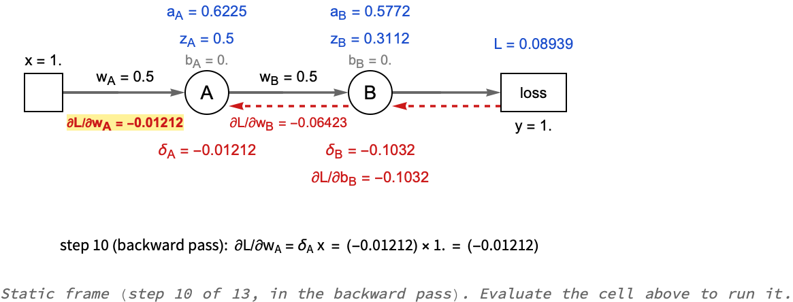

▶ **Video:** [Tiny-network-13-steps.mp4](videos/Tiny-network-13-steps.mp4), the 13 steps of Figure 0.1.

Repeating the three passes is training. After 100 steps the output is above 0.93 and still climbing towards 1. The rest of this notebook does exactly this, with more neurons per layer, matrices instead of single numbers, and many examples at once.

*Figure 0.2. 100 repetitions of forward, backward and update.*

```wolfram
(*c.0.5*)
(* repeat the same step: forward, backward, update. The output a_B
   climbs towards the target y = 1 and the loss falls *)
(* one learning step for the parameters {w_A, b_A, w_B, b_B} *)
gdStep[{p_, q_, r_, s_}] := Module[{a1, a2, d2, d1},
   a1 = LogisticSigmoid[p xIn + q]; a2 = LogisticSigmoid[r a1 + s];
   d2 = (a2 - yT) a2 (1 - a2); d1 = r d2 a1 (1 - a1);
   {p, q, r, s} - rate {d1 xIn, d1, d2 a1, d2}];
(* 100 steps from the hand-picked start *)
runP = NestList[gdStep, {wA, bA, wB, bB}, 100];
(* the output a_B after every step *)
outP = LogisticSigmoid[#[[3]] LogisticSigmoid[#[[1]] xIn + #[[2]]] +
      #[[4]]] & /@ runP;
figure[{{ListLinePlot[outP, PlotRange -> {0.5, 1}, Frame -> True,
     FrameLabel -> {"step", None}, ImagePadding -> {{45, 10}, {45, 30}},
     Evaluate@panel[PlotLabel ->
       Row[{"0.2a. output ", fm["a_B"]}]]],
    ListLogPlot[lossOf /@ runP, Joined -> True, Frame -> True,
     FrameLabel -> {"step", None}, ImagePadding -> {{45, 10}, {45, 30}},
     Evaluate@panel[PlotLabel -> "0.2b. loss L"]]}},
 "Figure 0.2. 100 learning steps of the tiny network"]
```

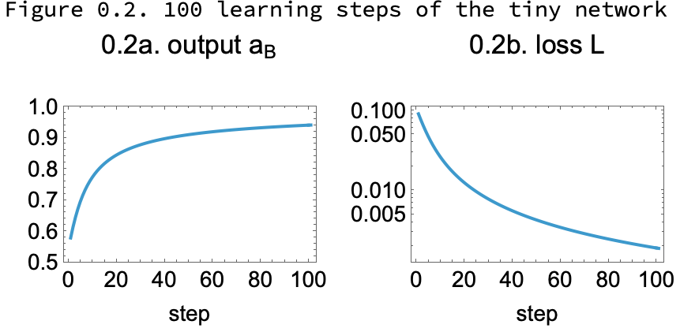

## 1. One neuron

A neuron takes n numbers $`{x}_{1}`$, …, $`{x}_{n}`$, multiplies each by a weight $`{w}_{i}`$, adds them and adds a bias b. The result z is then passed through an activation function, here the logistic sigmoid σ:

```math
\begin{gathered}z = w \cdot x + b = {\sum}_{i = 1}^{n} {w}_{i} \  {x}_{i} + b \\ w \cdot x = {w}^{T} x = \begin{pmatrix}{w}_{1} & {w}_{2} & \cdots & {w}_{n}\end{pmatrix} \begin{pmatrix}{x}_{1} \\ {x}_{2} \\ \vdots \\ {x}_{n}\end{pmatrix} = {w}_{1} {x}_{1} + {w}_{2} {x}_{2} + \cdots + {w}_{n} {x}_{n}\end{gathered} \quad  \tag{1}
```

```math
a = \sigma ( z ) = \frac{1}{1 + {e}^{- z}} \quad  \tag{2}
```

The dot product w·x is the matrix product of the row of weights with the column of inputs, as the second line of Eq. (1) shows: a 1 × n matrix times an n × 1 matrix gives a 1 × 1 matrix, the number z. Every computation in this notebook is built from this one product.

σ squeezes any real number into (0, 1): very negative z gives almost 0, very positive z almost 1, and z = 0 gives exactly 1/2. Its derivative has a convenient form, which backpropagation will use in every layer:

```math
{\sigma}^{\prime} ( z ) = \sigma ( z ) \  ( 1 - \sigma ( z ) ) \quad  \tag{3}
```

With two inputs that are 0 or 1, one neuron can compute logic. The weights 20, 20 and the bias -30 give z > 0 only when both inputs are 1: that is AND. With bias -10, z > 0 as soon as one input is 1: that is OR. The large weights make σ nearly a step.

*Table 1. AND and OR computed by one neuron: z and σ(z) for all four inputs.*

```wolfram
(*c.1*)
(* one neuron, Eqs. (1)-(2): weighted sum plus bias, then σ *)
neuron[w_, b_][x_] := LogisticSigmoid[w . x + b];
(* hand-picked weights: AND fires only when both inputs are 1,
   OR fires when at least one is *)
andN = neuron[{20, 20}, -30];
orN = neuron[{20, 20}, -10];
(* the four inputs (0,0), (0,1), (1,0), (1,1) *)
inputs = Tuples[{0, 1}, 2];
(* z = w·x + b and the output σ(z) for every input *)
table[Prepend[
  Table[{x[[1]], x[[2]], {20, 20} . x - 30, NumberForm[N@andN[x], 3],
    {20, 20} . x - 10, NumberForm[N@orN[x], 3]}, {x, inputs}],
  {Subscript["x", 1], Subscript["x", 2], "z (AND)", "σ(z) AND",
   "z (OR)", "σ(z) OR"}], "Table 1"]
```

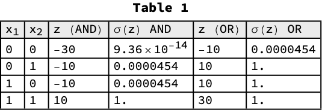

*Table 1b. The AND neuron written as matrices: the row (20 20) times the input column, plus the bias, for each of the four inputs.*

```wolfram
(*c.1b*)
(* the AND neuron in matrix form: w is a 1×2 row, x a 2×1 column, and
   w·x is the row times the column *)
wAND = {{20, 20}}; bAND = {-30};
table[Prepend[Table[{Row[{mat[wAND], " ", col[x], " + ", col[bAND],
       " = ", col[wAND . x + bAND]}],
     NumberForm[N@LogisticSigmoid[First[wAND . x + bAND]], 3]},
    {x, inputs}], {"z = w x + b", "σ(z)"}],
 "Table 1b. The AND neuron as a matrix product"]
```

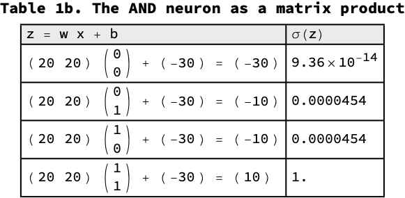

Geometrically, σ(w·x + b) > 1/2 exactly where w·x + b > 0, which is one side of the line w·x + b = 0. A neuron therefore splits the plane into two half-planes, with a soft transition of width about 1/|w| across the line.

*Figure 1. The output of the AND and OR neurons over the plane, from blue (0) to red (1). The dashed line is w·x + b = 0; white dots are inputs whose answer is 1.*

```wolfram
(*c.2*)
(* each neuron is a soft half-plane: σ(w·x + b) > 1/2 exactly where
   w·x + b > 0. The dashed line is the boundary w·x + b = 0 *)
(* nf: the neuron, b: its bias, truth: the logic rule for the dots *)
gatePlot[nf_, b_, lbl_, truth_] := DensityPlot[nf[{x1, x2}],
   {x1, -0.25, 1.25}, {x2, -0.25, 1.25}, PlotRange -> {0, 1},
   ColorFunction -> "TemperatureMap", PlotPoints -> 40,
   FrameLabel -> {Subscript["x", 1], Subscript["x", 2]},
   FrameTicks -> {{{0, 0.5, 1}, None}, {{0, 0.5, 1}, None}},
   Epilog -> {Dashed, Thick, Black,
     (* the line 20 x1 + 20 x2 + b = 0, solved for x2 *)
     Line[{{-0.25, (-b - 20 (-0.25))/20}, {1.25, (-b - 20 1.25)/20}}],
     PointSize[0.05], Table[{If[truth[x] == 1, White, Black],
       Point[x]}, {x, inputs}]},
   Evaluate@panel[PlotLabel -> lbl]];
figure[{{gatePlot[andN, -30, "1a. AND", BitAnd @@ # &],
   gatePlot[orN, -10, "1b. OR", BitOr @@ # &]}},
 "Figure 1. One neuron computes AND or OR (white = output 1)"]
```

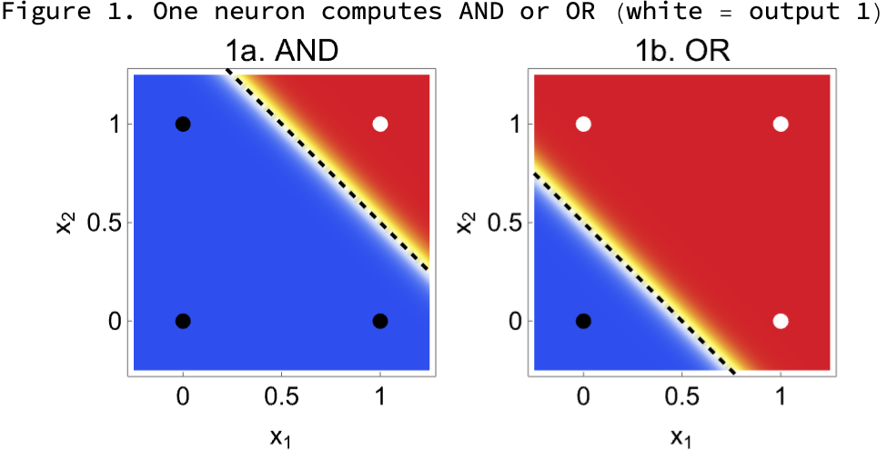

The same two neurons drawn as networks, the way every network in this notebook is drawn: squares are inputs, circles are neurons with their activation written inside (σ, or Σ for a plain weighted sum with no σ). Red lines are positive weights, blue lines negative ones, and a thicker line is a larger weight; on small networks the weights and biases are written out.

*Diagram 1. The AND and OR neurons of Table 1.*

```wolfram
(*c.2b*)
(* the AND and OR neurons as diagrams: squares are inputs, the circle
   is the neuron; numbers on the lines are weights, b is the bias *)
figure[{{netDiagram[{2, 1}, {{{{20, 20}}, {-30}}}, {Subscript["x", 1],
      Subscript["x", 2]}, {"AND"}, "σ", "D1a. AND"],
   netDiagram[{2, 1}, {{{{20, 20}}, {-10}}}, {Subscript["x", 1],
      Subscript["x", 2]}, {"OR"}, "σ", "D1b. OR"]}},
 "Diagram 1. The neurons of Table 1"]
```

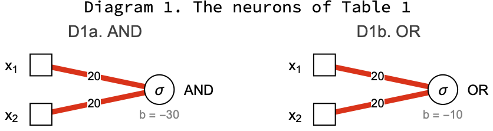

## 2. A layer is a matrix product

Put m neurons side by side, all reading the same input x. Their weight vectors become the rows of an m × n matrix W, their biases a vector b, and the whole layer is one matrix-vector product followed by σ applied to each component:

```math
\begin{gathered}\begin{pmatrix}{z}_{1} \\ {z}_{2} \\ \vdots \\ {z}_{m}\end{pmatrix} = \begin{pmatrix}{w}_{11} & {w}_{12} & \cdots & {w}_{1 n} \\ {w}_{21} & {w}_{22} & \cdots & {w}_{2 n} \\ \vdots & \vdots & \ddots & \vdots \\ {w}_{m 1} & {w}_{m 2} & \cdots & {w}_{m n}\end{pmatrix} \begin{pmatrix}{x}_{1} \\ {x}_{2} \\ \vdots \\ {x}_{n}\end{pmatrix} + \begin{pmatrix}{b}_{1} \\ {b}_{2} \\ \vdots \\ {b}_{m}\end{pmatrix} \\ a = \sigma ( z ) = \begin{pmatrix}\sigma ( {z}_{1} ) \\ \vdots \\ \sigma ( {z}_{m} )\end{pmatrix} , W \in {\mathbb{R}}^{m \times n}\end{gathered} \quad  \tag{4}
```

Row i of W holds the weights of neuron i; column j holds the weights that input $`{x}_{j}`$ sends to every neuron. Nothing more is going on inside a layer than this product.

*Table 2. A layer of 3 neurons on 2 inputs: the symbolic product W x + b, and one numeric example.*

```wolfram
(*c.3*)
(* a layer of m neurons is one matrix product, Eq. (4): z = W x + b,
   then σ applied to every component *)
layer[W_, b_][x_] := LogisticSigmoid[W . x + b];
(* symbols: w[i, j] is the weight from input j to neuron i *)
Wsym = Array[Subscript[w, #1, #2] &, {3, 2}];
bsym = Array[Subscript[b, #] &, 3];
xsym = {Subscript[x, 1], Subscript[x, 2]};
(* a numeric example: 2 inputs, 3 neurons *)
W1 = {{1., -2.}, {0.5, 0.5}, {-1., 3.}}; b1 = {0., -0.5, 1.};
x0 = {0.8, 0.3};
(* the product W x + b, symbolic and with numbers *)
table[{{"quantity", "value"},
  {"W x + b, symbolic", MatrixForm[Wsym . xsym + bsym]},
  {"W, numeric", MatrixForm[W1]}, {"b", MatrixForm[b1]},
  {"x", MatrixForm[x0]},
  {"z = W x + b", MatrixForm[W1 . x0 + b1]},
  {"a = σ(z)", MatrixForm[NumberForm[#, 4] & /@ layer[W1, b1][x0]]}},
 "Table 2"]
```

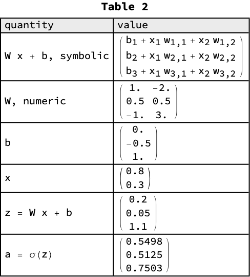

### The computing: many inputs at once

In practice a network is applied to many inputs, and a computer is much faster at one large matrix product than at many small ones. Put M inputs as the rows of an M × n matrix X. Then all M results come from one product, the bias is added to every row, and σ is applied entrywise:

```math
Z = X \  {W}^{T} + 1 \  {b}^{T} , A = \sigma ( Z ) , X \in {\mathbb{R}}^{M \times n} , A \in {\mathbb{R}}^{M \times m} \quad  \tag{5}
```

This row convention, one sample per row, is the one used in the code from now on; it is why the code writes X $`{W}^{T}`$ where the equations write W x.

*Table 3. 100000 inputs through the same layer, one at a time and as one matrix.*

```wolfram
(*c.4*)
(* the computing: M inputs at once. Put them as the rows of a matrix
   X (M × n); the whole layer is then one matrix product, Eq. (5) *)
layerBatch[W_, b_][X_] :=
  LogisticSigmoid[X . Transpose[W] + ConstantArray[b, Length[X]]];
SeedRandom[1];
(* 100000 random inputs, one per row *)
Xbig = RandomReal[{0, 1}, {100000, 2}];
(* time both: Map over the rows, and one matrix product *)
{tLoop, r1} = AbsoluteTiming[layer[W1, b1] /@ Xbig];
{tBatch, r2} = AbsoluteTiming[layerBatch[W1, b1][Xbig]];
table[{{"method", "time (s)", "same result?"},
  {"one input at a time (Map)", NumberForm[tLoop, 3], ""},
  {"all inputs as one matrix", NumberForm[tBatch, 3],
   Max@Abs[r1 - r2] < 10^-12},
  {"speed-up", NumberForm[tLoop/tBatch, 3], ""}}, "Table 3"]
```

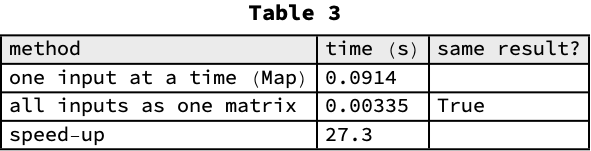

## 3. Stacking layers: the network

A network feeds the output of one layer into the next. Write the input as $`{a}^{0}`$ and number the layers l = 1, …, L; layer l has its own $`{W}^{l}`$ and $`{b}^{l}`$ (superscripts number layers here, they are not powers):

```math
\begin{gathered}{a}^{0} = x , {z}^{l} = {W}^{l} \  {a}^{l - 1} + {b}^{l} , {a}^{l} = \sigma ( {z}^{l} ) , l = 1 , \ldots , L \\ f ( x ) = {a}^{L} = \sigma ( {W}^{L} \  \sigma ( {W}^{L - 1} \  \ldots \sigma ( {W}^{1} x + {b}^{1} ) \ldots + {b}^{L - 1} ) + {b}^{L} )\end{gathered} \quad  \tag{6}
```

The second line writes the whole network as one function: a composition of affine maps and σ. Why is more than one layer needed? The classic answer is XOR [2].

**Theorem 1 (XOR is not linearly separable).** There are no w = ($`{w}_{1}`$, $`{w}_{2}`$) and b with w·x + b > 0 for x = (0,1) and (1,0) and w·x + b ≤ 0 for x = (0,0) and (1,1). Hence no single neuron computes XOR.

**Proof.** Adding the two strict inequalities $`{w}_{2}`$ + b > 0 and $`{w}_{1}`$ + b > 0 gives $`{w}_{1}`$ + $`{w}_{2}`$ + 2b > 0. Adding the other two, b ≤ 0 and $`{w}_{1}`$ + $`{w}_{2}`$ + b ≤ 0, gives $`{w}_{1}`$ + $`{w}_{2}`$ + 2b ≤ 0, a contradiction. ∎

*Table 4. The best a single neuron can do on XOR, by minimizing its squared error: it answers 0.5 everywhere.*

```wolfram
(*c.5*)
(* XOR: 1 when exactly one input is 1. Try the best single neuron:
   minimize the squared error over its three parameters *)
xorY = BitXor @@@ inputs;
single = NMinimize[Total[(LogisticSigmoid[{p, q} . # + r] & /@ inputs
       - xorY)^2], {p, q, r}, Method -> "DifferentialEvolution"];
(* the outputs of the best neuron: 0.5 for every input *)
table[Prepend[Table[{inputs[[k, 1]], inputs[[k, 2]], xorY[[k]],
     NumberForm[LogisticSigmoid[{p, q} . inputs[[k]] + r] /.
       single[[2]], 3]}, {k, 4}],
  {Subscript["x", 1], Subscript["x", 2], "XOR", "best single neuron"}],
 "Table 4"]
```

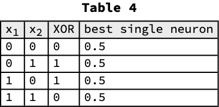

Two layers solve it. XOR is true when OR is true and NAND (not both) is true, and each of these is one neuron. So a hidden layer with an OR neuron and a NAND neuron, followed by an AND neuron, computes

```math
\begin{gathered}y = \sigma ( 20 \  \sigma ( 20 {x}_{1} + 20 {x}_{2} - 10 ) + 20 \  \sigma ( - 20 {x}_{1} - 20 {x}_{2} + 30 ) - 30 ) \\ y = \sigma ( \begin{pmatrix}20 & 20\end{pmatrix} \  \sigma ( \begin{pmatrix}20 & 20 \\ - 20 & - 20\end{pmatrix} \  \begin{pmatrix}{x}_{1} \\ {x}_{2}\end{pmatrix} + \begin{pmatrix}- 10 \\ 30\end{pmatrix} ) - 30 )\end{gathered} \quad  \tag{7}
```

*Table 5. The forward pass of the XOR network for the four inputs, with every intermediate value.*

```wolfram
(*c.6*)
(* a 2-2-1 network that computes XOR, Eq. (7): hidden neuron 1 is OR,
   hidden neuron 2 is NAND, the output neuron is AND of the two *)
Wh = {{20., 20.}, {-20., -20.}}; bh = {-10., 30.};
Wo = {{20., 20.}}; bo = {-30.};
(* the network: the hidden layer first, then the output layer *)
xorNet[x_] := layer[Wo, bo][layer[Wh, bh][x]];
(* every intermediate value of the forward pass *)
table[Prepend[Table[With[{zh = Wh . x + bh},
     With[{h = LogisticSigmoid[zh]}, {x, zh, NumberForm[h, 3],
       NumberForm[First[Wo . h + bo], 3],
       NumberForm[First@xorNet[x], 3], BitXor @@ x}]], {x, inputs}],
  {"x", "z hidden", "h = σ(z)", "z out", "output", "XOR"}], "Table 5"]
```

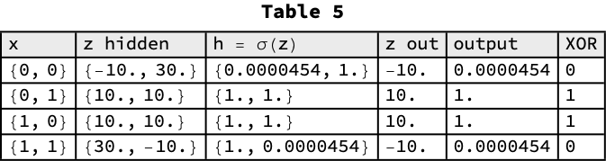

The same network in matrix form. The hidden layer has 2 neurons reading 2 inputs, so its W is 2 × 2 (row i holds the weights of neuron i) and b has 2 entries; the output layer has 1 neuron reading 2 hidden values, so its W is 1 × 2. The second line of Eq. (7) writes the network with these matrices. With the four inputs as the rows of X, Eq. (5) computes all of them with one product per layer.

*Table 5b. The XOR network as matrix products: first for the input (1, 0), then for all four inputs at once. Note the shapes: X is 4 × 2, Wᵀ is 2 × 2, and Z is 4 × 2, one row per input and one column per hidden neuron.*

```wolfram
(*c.6b*)
(* the XOR network in matrices: one input, then all four at once.
   Hidden layer: W is 2×2 (2 neurons × 2 inputs), b is 2×1. Output
   layer: W is 1×2 (1 neuron × 2 hidden values), b is 1×1 *)
xEx = {1, 0};
zH = Wh . xEx + bh; hH = LogisticSigmoid[zH];
zO = Wo . hH + bo;
(* batch, Eq. (5): the 4 inputs are the rows of X (4×2) *)
ZH = N[inputs] . Transpose[Wh] + ConstantArray[bh, 4];
HH = LogisticSigmoid[ZH];
ZO = HH . Transpose[Wo] + ConstantArray[bo, 4];
mtable[{
   {"hidden layer, x = (1, 0):  z = W x + b,  h = σ(z)",
    Row[{mat[Wh], " ", col[xEx], " + ", col[bh], " = ", col[zH],
      ",    σ", col[zH], " = ", col[hH]}]},
   {"output layer:  z = W h + b,  y = σ(z)",
    Row[{mat[Wo], " ", col[hH], " + ", col[bo], " = ", col[zO],
      ",    σ", col[zO], " = ", col[LogisticSigmoid[zO]]}]},
   {"hidden layer, all 4 inputs as rows:  Z = X Wᵀ + B",
    Row[{mat[N@inputs], " ", mat[Transpose[Wh]], " + ",
      mat[ConstantArray[bh, 4]], " = ", mat[ZH]}]},
   {"H = σ(Z), entry by entry", Row[{"σ", mat[ZH], " = ", mat[HH]}]},
   {"output layer, all 4 inputs:  Z = H Wᵀ + B,  Y = σ(Z)",
    Row[{mat[HH], " ", mat[Transpose[Wo]], " + ",
      mat[ConstantArray[bo, 4]], " = ", mat[ZO], ",    σ", mat[ZO],
      " = ", mat[LogisticSigmoid[ZO]]}]}},
 "Table 5b. The XOR network as matrix products"]
```

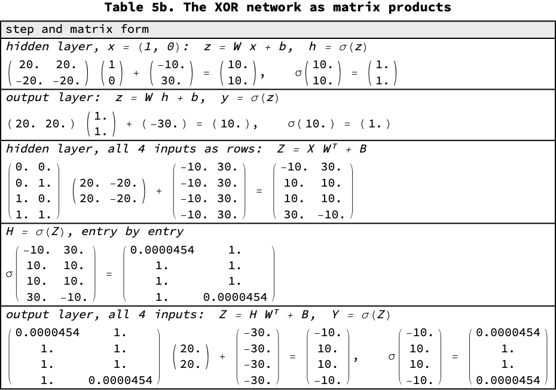

*Figure 2. The XOR network as a graph, in the style of Figure M3. Red: weights on the arrows; blue: biases of the neurons.*

```wolfram
(*c.7*)
(* the XOR network drawn like Figure M3 of S Shape Functions Theory;
   red labels are the weights, blue the biases *)
xorEdges = {"x1" -> "h1", "x2" -> "h1", "x1" -> "h2", "x2" -> "h2",
   "h1" -> "y", "h2" -> "y"};
figure[{{Graph[DirectedEdge @@@ xorEdges,
 VertexCoordinates -> {"x1" -> {0, 1}, "x2" -> {0, -1}, "h1" -> {2.5, 1},
   "h2" -> {2.5, -1}, "y" -> {5, 0}},
 VertexLabels -> {"x1" -> Placed[Subscript["x", 1], Before],
   "x2" -> Placed[Subscript["x", 2], Before],
   "h1" -> Placed[Row[{"OR,  b = ", Style[-10, Blue]}], Above],
   "h2" -> Placed[Row[{"NAND,  b = ", Style[30, Blue]}], Below],
   "y" -> Placed[Row[{"AND,  b = ", Style[-30, Blue]}], Above]},
 VertexLabelStyle -> Directive[Black, figFont - 1],
 EdgeLabels -> Thread[DirectedEdge @@@ xorEdges ->
    (Placed[#, 0.35] & /@ {20, 20, -20, -20, 20, 20})],
 EdgeLabelStyle -> Directive[figFont - 1, Darker[Red],
   Background -> White],
 VertexSize -> 0.25, EdgeStyle -> Arrowheads[0.03], ImageSize -> wFull,
 ImagePadding -> {{40, 20}, {35, 35}}]}},
 "Figure 2. A 2-2-1 network that computes XOR"]
```

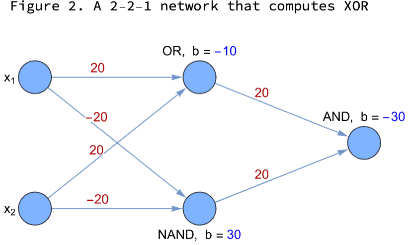

The hidden layer does not answer the question; it changes the question. It moves the four inputs to new points h = σ(W x + b). The two inputs whose answer is 1 both land on (1, 1), and the other two on (0, 1) and (1, 0). In these new coordinates one straight line separates the classes, and a single output neuron can finish the job. This is what hidden layers do in general: they transform the data until a simple rule works.

*Figure 3. Left: the XOR inputs, which no line separates. Right: the same points after the hidden layer, separated by the dashed line $`{h}_{1}`$ + $`{h}_{2}`$ = 1.5.*

```wolfram
(*c.8*)
(* why the hidden layer helps: it moves the four inputs to new points
   h = σ(W x + b). In the input plane no line separates the XOR
   classes; in the hidden plane one line does *)
hid = layer[Wh, bh] /@ inputs;
(* labels: (0,1) and (1,0) land on the same hidden point, so one
   label goes above it and one below *)
offs = {{0, 0.13}, {0, 0.13}, {0, -0.13}, {0, 0.13}};
pts[ps_] := Table[{If[xorY[[k]] == 1, Red, Blue], PointSize[0.06],
    Point[ps[[k]]], Black, Text[Style[ToString[inputs[[k]]],
      figFont - 3], ps[[k]] + offs[[k]]]}, {k, 4}];
figure[{{
   Graphics[pts[N@inputs], Frame -> True, PlotRange -> {{-0.3, 1.3},
      {-0.3, 1.4}}, PlotRangeClipping -> True,
    FrameLabel -> {Subscript["x", 1], Subscript["x", 2]},
    Evaluate@panel[PlotLabel -> "3a. inputs"]],
   Graphics[{pts[hid], Dashed, Line[{{-0.2, 1.7}, {1.7, -0.2}}]},
    Frame -> True, PlotRange -> {{-0.3, 1.3}, {-0.3, 1.4}},
    PlotRangeClipping -> True,
    FrameLabel -> {Subscript["h", 1], Subscript["h", 2]},
    Evaluate@panel[PlotLabel -> "3b. hidden layer"]]}},
 "Figure 3. Red = XOR 1, blue = XOR 0"]
```

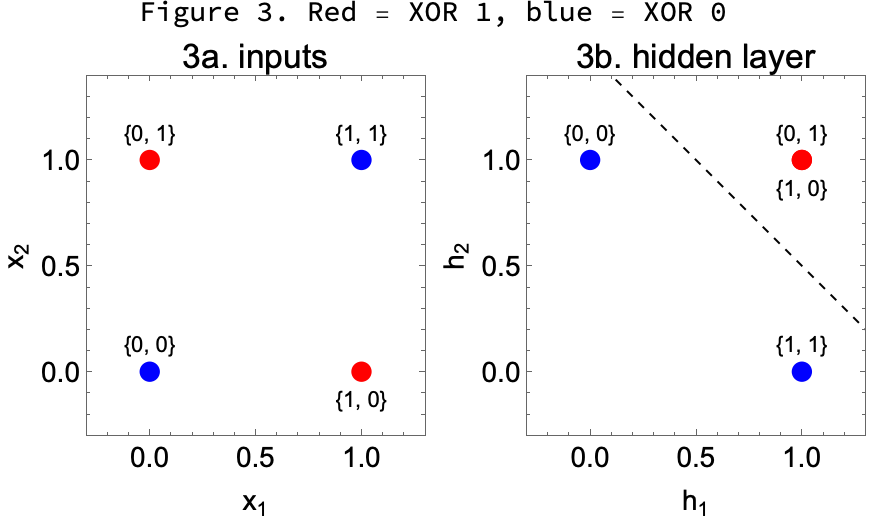

**Theorem 2 (universal approximation).** One hidden layer of σ neurons is already enough to approximate any continuous function on a cube as closely as wanted, given enough neurons (Cybenko [3]; Theorem M2 of [1]). Depth is a matter of efficiency, not of possibility.

## 4. Measuring the error: the loss

To learn, the network needs a number that says how wrong it is. For M examples $`{x}_{m}`$ with answers $`{y}_{m}`$, the squared error averages the squared distance between output and answer (the factor 1/2 only simplifies the derivative):

```math
L = \frac{1}{2 M} {\sum}_{m = 1}^{M} {\Vert {a}^{L} ( {x}_{m} ) - {y}_{m} \Vert}^{2} \quad  \tag{8}
```

For classification into K classes, the answers are written one-hot: y has a 1 in the position of the true class and 0 elsewhere. The output layer uses softmax, which turns K numbers into K probabilities, and the loss is the cross-entropy, the average of minus the log of the probability given to the true class. Softmax outputs are positive and add up to 1:

```math
{a}_{k} = \frac{{e}^{{z}_{k}}}{\sum_{j} {e}^{{z}_{j}}} \quad  \tag{9}
```

```math
L = - \frac{1}{M} {\sum}_{m = 1}^{M} \sum_{k} {y}_{mk} \  \log  \  {a}_{mk} \quad  \tag{10}
```

## 5. Backpropagation: the chain rule, organized

Training changes every weight a little in the direction that lowers the loss, so it needs the gradient: the derivative of L with respect to every entry of every $`{W}^{l}`$ and $`{b}^{l}`$. Backpropagation [4] computes all of them in one backward sweep, at about the cost of one forward pass; textbook accounts are in [5] and [6].

**Theorem 3 (backpropagation).** Let $`{\delta}^{l}`$ = ∂L/∂$`{z}^{l}`$ be the derivative of the loss with respect to the weighted sums of layer l. Then $`{\delta}^{L}`$ is given by Eq. (11): the first form for a σ output with the squared error, the second for a softmax output with the cross-entropy and for a linear output with the squared error. The earlier $`{\delta}^{l}`$ follow from the backward recursion Eq. (12), and the gradients from Eq. (13). Here ⊙ is the Hadamard product: entry-by-entry multiplication of two vectors (or matrices) of the same shape: entry i of u ⊙ v is $`{u}_{i}`$ $`{v}_{i}`$.

```math
{\delta}^{L} = ( {a}^{L} - y ) \odot {\sigma}^{\prime} ( {z}^{L} ) \quad \text{or} \quad  {\delta}^{L} = {a}^{L} - y \quad  \tag{11}
```

```math
{\delta}^{l} = ( {( {W}^{l + 1} )}^{T} \  {\delta}^{l + 1} ) \odot {\sigma}^{\prime} ( {z}^{l} ) , l = L - 1 , \ldots , 1 \quad  \tag{12}
```

```math
\frac{\partial L}{\partial {W}^{l}} = {\delta}^{l} \  {( {a}^{l - 1} )}^{T} , \frac{\partial L}{\partial {b}^{l}} = {\delta}^{l} \quad  \tag{13}
```

**Proof.** At the output, L depends on $`{z}^{L}`$ through $`{a}^{L}`$ = σ($`{z}^{L}`$), so the chain rule gives ($`{a}^{L}`$ - y) times σ′($`{z}^{L}`$) for the squared error; for softmax with cross-entropy the factors combine and leave $`{a}^{L}`$ - y. For an earlier layer, $`{z}^{l}`$ affects L only through the weighted sums of the next layer, which are W σ($`{z}^{l}`$) + b with that layer's W and b. Differentiating this composition gives the transpose of the next layer's W applied to the next layer's δ, times σ′($`{z}^{l}`$) entrywise, which is Eq. (12). Finally $`{z}^{l}`$ depends linearly on $`{W}^{l}`$ and $`{b}^{l}`$, with coefficients the previous activations and 1, which gives Eq. (13). For M samples the gradients are averaged. ∎

Read Eq. (12) as Figure M3 read backwards: the error signal δ flows from the output to the input along the same arrows, multiplied by the same weights, now transposed.

The operator ⊙ is the Hadamard product, also called the entrywise or Schur product. It multiplies two vectors or matrices of the same shape entry by entry, with no sums: entry i of u ⊙ v is $`{u}_{i}`$ $`{v}_{i}`$, and entry (i, j) of A ⊙ B is $`{A}_{ij}`$ $`{B}_{ij}`$. For example (1, 2, 3) ⊙ (4, 5, 6) = (4, 10, 18), whereas the dot product of the same vectors is the single number 32. In Eq. (12) it applies to each neuron its own factor σ′($`{z}_{i}`$): neuron i passes back only as much error as its σ is sensitive at its own $`{z}_{i}`$. In Wolfram Language two lists of the same shape multiplied with a space or * are multiplied entrywise, so A (1 - A) and d A (1 - A) in the code are exactly ⊙ products.

Cell c.9 programs Eqs. (6), (8)–(13) for any number of layers, in the row convention of Eq. (5).

```wolfram
(*c.9*)
(* a network is a list of layers {W, b}. In the code the M samples are
   the rows of a matrix, so Eq. (6) z = W a + b becomes Z = A Wᵀ + b *)
sigma = LogisticSigmoid;
(* softmax row by row; subtracting the row maximum avoids overflow *)
softmax[Z_] := With[{ez = Exp[Z - Max /@ Z]}, ez/Total[ez, {2}]];
(* affine map of a layer, rows = samples: A Wᵀ + b in every row *)
affine[{W_, b_}, A_] := A . Transpose[W] + ConstantArray[b, Length[A]];
(* forward pass: keep every A^(l); out is the output activation *)
forward[net_, X_, out_] := FoldList[
   Function[{A, l}, If[l == Length[net], out, sigma][affine[net[[l]], A]]],
   X, Range[Length[net]]];
(* three kinds of output: "mse" = σ output with squared error,
   "lin" = linear output with squared error, "ce" = softmax output
   with cross-entropy; the losses are Eqs. (8) and (10) *)
loss["mse"][P_, Y_] := Total[(P - Y)^2, 2]/(2 Length[Y]);
loss["lin"][P_, Y_] := loss["mse"][P, Y];
loss["ce"][P_, Y_] := -Total[Y Log[P + 10.^-15], 2]/Length[Y];
outAct = <|"mse" -> sigma, "lin" -> Identity, "ce" -> softmax|>;
(* backpropagation, Theorem 3: the output delta of Eq. (11), then
   Eq. (12) layer by layer, and the gradients of Eq. (13) *)
backprop[net_, X_, Y_, kind_] := Module[{As, L = Length[net], d, g = {}},
   (* forward pass, keeping the activations of every layer *)
   As = forward[net, X, outAct[kind]];
   (* Eq. (11): σ output adds the factor σ′; "lin" and "ce" do not *)
   d = If[kind == "mse", (Last[As] - Y) Last[As] (1 - Last[As]),
      Last[As] - Y]/Length[Y];
   (* from the last layer back: gradients of W and b, Eq. (13),
      then δ of the layer before, Eq. (12) *)
   Do[PrependTo[g, {Transpose[d] . As[[l]], Total[d]}];
    If[l > 1, d = (d . net[[l, 1]]) As[[l]] (1 - As[[l]])],
    {l, L, 1, -1}];
   {loss[kind][Last[As], Y], g}];
(* random start: normal weights with sd 1/√(inputs), zero biases *)
initNet[sizes_] := Table[{RandomReal[NormalDistribution[0,
      1/Sqrt[sizes[[l]]]], {sizes[[l + 1]], sizes[[l]]}],
    ConstantArray[0., sizes[[l + 1]]]}, {l, Length[sizes] - 1}];
"forward, backprop and initNet defined"
```

**Output:** `forward, backprop and initNet defined`

A backpropagation program can be wrong in ways that still learn a little, so it is checked three ways on a small random network: against symbolic differentiation with D and against central finite differences of the loss.

*Table 6. Backpropagation against D and against finite differences.*

```wolfram
(*c.10*)
(* check backprop three ways on a small random 2-3-2 network *)
SeedRandom[4];
netT = initNet[{2, 3, 2}]; XT = RandomReal[{-1, 1}, {5, 2}];
YT = RandomReal[{0, 1}, {5, 2}];
(* the gradients by backprop, Theorem 3 *)
{lossT, gT} = backprop[netT, XT, YT, "mse"];
(* 1: automatic differentiation with D on symbolic weights *)
sym = {{Array[wa, {3, 2}], Array[ba, 3]}, {Array[wb, {2, 3}],
    Array[bb, 2]}};
rules = Thread[Flatten[sym] -> Flatten[netT]];
symLoss = loss["mse"][Last@forward[sym, XT, sigma], YT];
(* level -2 holds the symbols wa[i, j], ba[i], ... themselves *)
gD = Map[D[symLoss, #] &, sym, {-2}] /. rules;
(* 2: central finite differences on every weight *)
flat = Flatten[netT]; shape[v_] := Module[{i = 0},
   Map[(i++; v[[i]]) &, netT, {-1}]];
lossAt[v_] := loss["mse"][Last@forward[shape[v], XT, sigma], YT];
gFD = shape@Table[(lossAt[flat + 10.^-6 UnitVector[Length[flat], k]] -
       lossAt[flat - 10.^-6 UnitVector[Length[flat], k]])/(2 10.^-6),
    {k, Length[flat]}];
(* all differences should be at rounding level *)
table[{{"comparison", "largest difference"},
  {"backprop vs D", sci@Max@Abs[Flatten[gT - gD]]},
  {"backprop vs finite differences", sci@Max@Abs[Flatten[gT - gFD]]},
  {"largest gradient entry", sci@Max@Abs[Flatten[gT]]}}, "Table 6"]
```

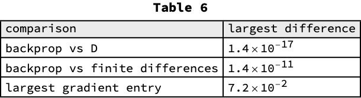

## 6. Gradient descent: training XOR

Gradient descent repeats one step: compute the gradient by backpropagation and move every weight a small distance η, the learning rate, against it:

```math
{W}^{l} \leftarrow {W}^{l} - \eta \  \frac{\partial L}{\partial {W}^{l}} , {b}^{l} \leftarrow {b}^{l} - \eta \  \frac{\partial L}{\partial {b}^{l}} \quad  \tag{14}
```

```wolfram
(*c.11*)
(* gradient descent, Eq. (14): step every W and b against its gradient;
   keep a snapshot of the network every `every` epochs *)
train[net0_, X_, Y_, kind_, eta_, epochs_, every_] := Module[
   {net = net0, l, g, hist = {}},
   (* each epoch: loss and gradient by backprop, keep a snapshot,
      then the step W ← W - η ∂L/∂W for every layer at once *)
   Do[{l, g} = backprop[net, X, Y, kind];
    If[Mod[e - 1, every] == 0, AppendTo[hist, {e - 1, l, net}]];
    net = net - eta g, {e, epochs}];
   AppendTo[hist, {epochs, First@backprop[net, X, Y, kind], net}]];
"train defined"
```

**Output:** `train defined`

A 2-3-1 network with random starting weights is trained on the four XOR examples, with the squared error and η = 4. One pass over the data is an epoch.

*Table 7. The loss and the four outputs during training. The network first drifts to 0.5 everywhere, the single-neuron answer of Table 4, then breaks the symmetry around epoch 300 and settles on XOR.*

```wolfram
(*c.12*)
(* train a 2-3-1 network on XOR from random weights *)
SeedRandom[7];
xorX = N[inputs]; xorT = List /@ N[xorY];
(* η = 4, 3000 epochs, a snapshot every 25 epochs *)
histX = train[initNet[{2, 3, 1}], xorX, xorT, "mse", 4., 3000, 25];
(* the loss and the four outputs at a few snapshots *)
table[Prepend[Table[With[{h = histX[[k]]}, {h[[1]], sci[h[[2]]],
      Sequence @@ (NumberForm[#, 3] & /@
         Flatten@Last@forward[h[[3]], xorX, sigma])}],
    {k, {1, 5, 9, 13, 21, 41, 81, Length[histX]}}],
  {"epoch", "loss", "out (0,0)", "out (0,1)", "out (1,0)",
   "out (1,1)"}], "Table 7"]
```

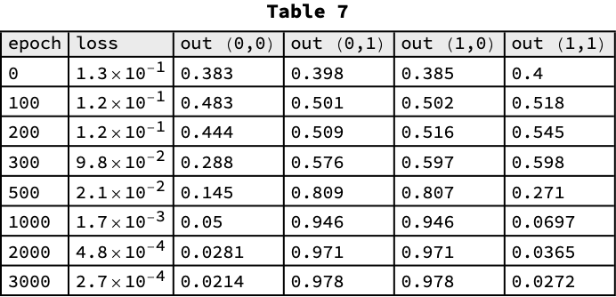

*Diagram 2. The trained 2-3-1 XOR network. Compare it with the hand-built network of Figure 2: training has found its own solution, with three hidden neurons instead of two.*

```wolfram
(*c.12b*)
(* the trained XOR network: red = positive weight, blue = negative,
   thicker = larger *)
figure[{{netDiagram[{2, 3, 1}, histX[[-1, 3]], {Subscript["x", 1],
      Subscript["x", 2]}, {"XOR"}, "σ", ""]}},
 "Diagram 2. The 2-3-1 network after training on XOR"]
```

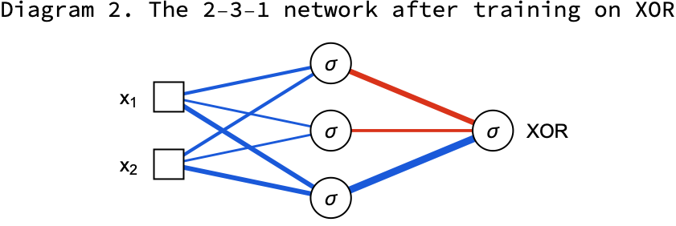

Backpropagation is matrix algebra too. With the examples as rows, the δ of a layer is an M × (neurons) matrix, the gradient of W is δᵀ times the activations of the layer before, and the δ of the layer before is δ W, multiplied entrywise by σ′, Eqs. (11)–(13) in the row convention. Here are all of these matrices for the first step of the training of Table 7.

*Table 7b. One backward pass of the 2-3-1 network at epoch 0, for the 4 XOR examples. The last line checks that the matrix formulas give exactly the gradient computed by backprop in cell c.9.*

```wolfram
(*c.12c*)
(* backpropagation in matrices, on the first training step of Table 7:
   the 2-3-1 network at epoch 0, all 4 XOR examples. Rows are
   examples, so every δ is 4 × (neurons of its layer) *)
net0 = histX[[1, 3]];
{A0, A1, A2} = forward[net0, xorX, sigma];
d2 = (A2 - xorT) A2 (1 - A2)/4;              (* Eq. (11), 4×1 *)
gW2 = Transpose[d2] . A1; gb2 = Total[d2];   (* Eq. (13) *)
d1 = (d2 . net0[[2, 1]]) A1 (1 - A1);        (* Eq. (12), 4×3 *)
gW1 = Transpose[d1] . A0; gb1 = Total[d1];
table[{{"quantity", "size", "value"},
   {"output δ = (a - y) ⊙ a ⊙ (1 - a)/M", "4×1", mat[d2]},
   {"∂L/∂W (output) = δᵀ A (hidden)", "1×3", mat[gW2]},
   {"hidden δ = (δ W) ⊙ A ⊙ (1 - A)", "4×3", mat[d1]},
   {"∂L/∂W (hidden) = δᵀ X", "3×2", mat[gW1]},
   {"∂L/∂b (hidden) = column sums of δ", "3", col[gb1]},
   {"same as backprop of c.9?", "",
    gW1 == backprop[net0, xorX, xorT, "mse"][[2, 1, 1]]}},
 "Table 7b. One backward pass in matrix form"]
```

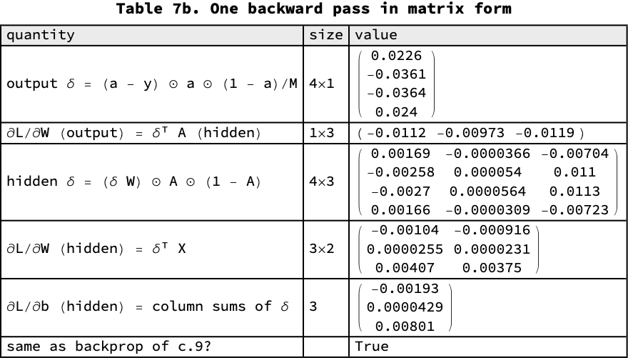

*Figure 4. Move the slider through the training. Left: the output of the network over the plane, with the four inputs (white = answer 1). Right: the loss, with the current epoch marked.*

```wolfram
(*c.13*)
(* precompute, for every snapshot, the network output on a grid of
   the plane; the Manipulate below then only looks values up *)
gr = Range[-0.25, 1.25, 0.05];
gridPts = Tuples[{gr, gr}];
surfX = Table[Transpose@Partition[Flatten@Last@forward[h[[3]], gridPts,
        sigma], Length[gr]], {h, histX}];
(* epoch and loss of every snapshot, for the loss curve *)
lossX = histX[[All, {1, 2}]];
(* one view: output over the plane (left), loss with the current
   epoch in red (right) *)
xorView[k_] := Grid[{{
    ListDensityPlot[surfX[[k]], DataRange -> {{-0.25, 1.25},
       {-0.25, 1.25}}, PlotRange -> {0, 1}, InterpolationOrder -> 1,
     ColorFunction -> "TemperatureMap", FrameLabel -> {Subscript["x", 1],
       Subscript["x", 2]}, FrameTicks -> {{{0, 1}, None}, {{0, 1}, None}},
     Epilog -> {PointSize[0.05], Table[{If[xorY[[j]] == 1, White, Black],
         Point[inputs[[j]]]}, {j, 4}]},
     PlotLabel -> "epoch " <> ToString[lossX[[k, 1]]],
     LabelStyle -> figStyle, ImageSize -> wHalf],
    ListLogPlot[lossX, Joined -> True, PlotRange -> All, Frame -> True,
     FrameTicks -> {{Automatic, None}, {{0, 1500, 3000}, None}},
     FrameLabel -> {"epoch", None}, AspectRatio -> 1,
     Epilog -> {Red, PointSize[0.04], Point[{lossX[[k, 1]],
         Log[lossX[[k, 2]]]}]},
     PlotLabel -> "loss", LabelStyle -> figStyle, ImageSize -> wHalf]}}];
Manipulate[xorView[k],
 {{k, 1, "snapshot"}, 1, Length[histX], 1, Appearance -> "Labeled"},
 SaveDefinitions -> True]
```

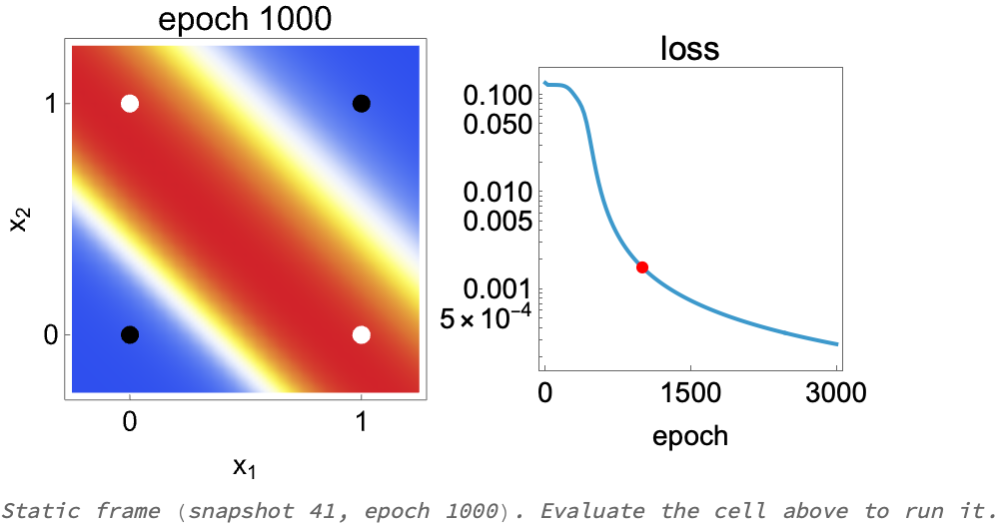

*Figure 5. The same training as an animation of the output surface.*

```wolfram
(*c.14*)
(* the same training as an animation: press play *)
xorFrames = Table[ListDensityPlot[surfX[[k]],
    DataRange -> {{-0.25, 1.25}, {-0.25, 1.25}}, PlotRange -> {0, 1},
    InterpolationOrder -> 1, ColorFunction -> "TemperatureMap",
    FrameTicks -> {{{0, 1}, None}, {{0, 1}, None}},
    Epilog -> {PointSize[0.05], Table[{If[xorY[[j]] == 1, White, Black],
        Point[inputs[[j]]]}, {j, 4}]},
    PlotLabel -> "XOR, epoch " <> ToString[lossX[[k, 1]]],
    LabelStyle -> figStyle, ImageSize -> wHalf],
   {k, Join[Range[1, 40], Range[42, Length[histX], 4]]}];
ListAnimate[xorFrames, AnimationRate -> 8, AnimationRepetitions -> Infinity,
 AnimationRunning -> False]  (* starts only when play is pressed *)
```

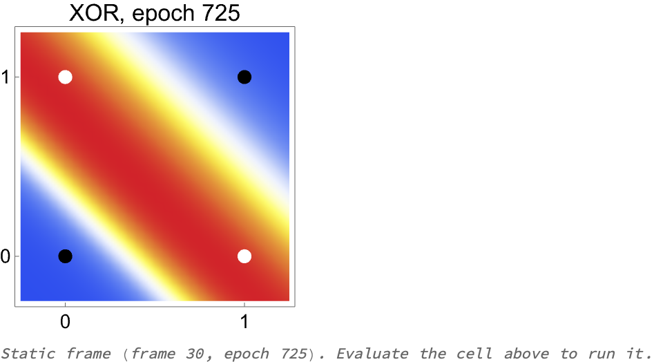

▶ **Video:** [XOR-training.mp4](videos/XOR-training.mp4), the XOR training of Figure 5.

## 7. A neuron learns Celsius to Fahrenheit

The simplest learning problem everyone knows the answer to: temperatures in Celsius and in Fahrenheit. The rule is F = 1.8 C + 32, but the network is not told; it only sees eight pairs.

*Table 8. Eight familiar temperatures.*

```wolfram
(*c.15*)
(* temperatures everybody knows, in °C and °F *)
temps = {{"cold winter day", -40}, {"freezer", -18},
   {"water freezes", 0}, {"spring day", 10}, {"room", 21},
   {"body", 37}, {"hot summer day", 45}, {"water boils", 100}};
(* the exact rule, which the neuron is not told *)
fahr[c_] := 9/5 c + 32;
table[Prepend[{#1, #2, N@fahr[#2]} & @@@ temps,
  {"", "°C", "°F"}], "Table 8"]
```

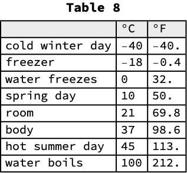

One neuron with no activation function, F = w u + b, is enough, because the rule is a straight line. The input is u = C/100 so that both parameters are of a similar size; the slope per degree is then w/100. The loss and its gradient are

```math
\begin{gathered}L ( w , b ) = \frac{1}{2 M} {\sum}_{m = 1}^{M} {( w \  {u}_{m} + b - {F}_{m} )}^{2} , {u}_{m} = \frac{{C}_{m}}{100} \\ \frac{\partial L}{\partial w} = \frac{1}{M} \sum_{m} {r}_{m} \  {u}_{m} , \frac{\partial L}{\partial b} = \frac{1}{M} \sum_{m} {r}_{m} , {r}_{m} = w \  {u}_{m} + b - {F}_{m}\end{gathered} \quad  \tag{15}
```

which is Eq. (11) with a linear output: the error signal is just the residual $`{r}_{m}`$.

*Table 9. Learning the rule from w = 0, b = 0, with η = 0.5. After 200 epochs the neuron has found F = 1.8 C + 32 to all digits shown.*

```wolfram
(*c.16*)
(* one linear neuron, F = w (C/100) + b: no hidden layer, no σ. The
   input is divided by 100 so that w and b are of similar size; then
   the slope per degree is w/100 and should come out as 9/5 = 1.8 *)
(* inputs u = C/100 and targets F, one example per row *)
cX = List /@ N[temps[[All, 2]]/100];
fY = List /@ N[fahr /@ temps[[All, 2]]];
SeedRandom[3];
(* start from w = b = 0; η = 0.5, 400 epochs *)
histT = train[{{{{0.}}, {0.}}}, cX, fY, "lin", 0.5, 400, 2];
(* read w and b out of a snapshot *)
wb[h_] := {h[[3, 1, 1, 1, 1]], h[[3, 1, 2, 1]]};
table[Prepend[Table[With[{h = histT[[k]]}, {h[[1]], NumberForm[h[[2]], 4],
      NumberForm[wb[h][[1]]/100, 4], NumberForm[wb[h][[2]], 4]}],
    {k, {1, 2, 6, 11, 26, 51, 101, Length[histT]}}],
  {"epoch", "loss", "slope w/100", "intercept b"}], "Table 9"]
```

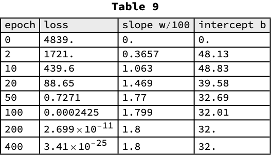

*Diagram 3. The trained temperature neuron: weight 180 on C/100, that is 1.8 per degree, and bias 32.*

```wolfram
(*c.16b*)
(* the temperature neuron after training: Σ marks a linear output,
   no σ is applied *)
figure[{{netDiagram[{1, 1}, histT[[-1, 3]], {"C/100"}, {"F"}, "Σ", ""]}},
 "Diagram 3. The Celsius-Fahrenheit neuron, F = w C/100 + b"]
```

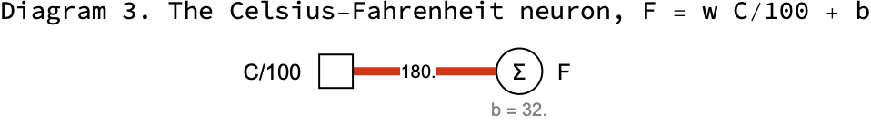

*Table 9b. The trained temperature neuron as a matrix product. All matrices are 1 × 1: the smallest case of Eq. (4).*

```wolfram
(*c.16c*)
(* the trained temperature neuron in matrix form: here every matrix is
   1×1, so the product is an ordinary product *)
{{wT}, bT} = {histT[[-1, 3, 1, 1]], histT[[-1, 3, 1, 2]]};
table[Prepend[Table[{Row[{c, " °C"}], Row[{mat[wT], " ", col[{c/100.}],
       " + ", col[bT], " = ", col[wT . {c/100.} + bT]}]},
    {c, {37, 100}}], {"C", "F = w u + b,  u = C/100"}],
 "Table 9b. The temperature neuron as a matrix product"]
```

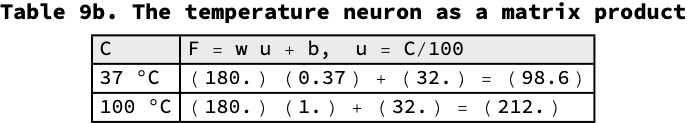

With only two parameters the loss can be drawn as a landscape over the (w, b) plane. Its valley is a long, tilted ellipse: lowering w can be traded for raising b. Gradient descent first runs steeply downhill, overshooting in b, and then slides along the valley floor to the bottom at (180, 32).

*Figure 6. Move the slider. Left: the path of (w, b) on the contours of the loss; the red dot is the answer. Right: the current line against the eight temperatures.*

```wolfram
(*c.17*)
(* the loss as a landscape over (w, b), Eq. (15); gradient descent
   walks downhill on it. Move the slider to follow the walk *)
lossWB[w_, b_] := Mean[(w cX[[All, 1]] + b - fY[[All, 1]])^2]/2;
(* the (w, b) of every snapshot: the path of gradient descent *)
pathT = wb /@ histT;
(* contours of log10 of the loss; the red dot is the answer (180, 32) *)
landscape = ContourPlot[Log10[lossWB[w, b] + 0.1], {w, -20, 260},
   {b, -20, 80}, Contours -> 14, PlotPoints -> 40,
   ColorFunction -> "BlueGreenYellow", ContourStyle -> Opacity[0.3],
   FrameLabel -> {"w", "b"}, LabelStyle -> figStyle,
   FrameTicks -> {{{0, 40, 80}, None}, {{0, 100, 200}, None}},
   Epilog -> {Red, PointSize[0.025], Point[{180, 32}]}];
(* one view: the path on the loss (left), the line against the
   data (right) *)
celsiusView[k_] := Grid[{{
    Show[landscape, Graphics[{White, Thick, Line[Take[pathT, k]],
       PointSize[0.03], Point[pathT[[k]]]}],
     PlotLabel -> "the walk on the loss", ImageSize -> wHalf],
    Plot[pathT[[k, 1]] c/100 + pathT[[k, 2]], {c, -50, 110},
     PlotRange -> {-80, 260}, Frame -> True,
     FrameLabel -> {"°C", "°F"}, AspectRatio -> 1,
     Epilog -> {Red, PointSize[0.03], Point[Transpose[
         {100 cX[[All, 1]], fY[[All, 1]]}]]},
     PlotLabel -> Row[{"F = ", NumberForm[pathT[[k, 1]]/100, 3],
        " C + ", NumberForm[pathT[[k, 2]], 3]}],
     LabelStyle -> figStyle, ImageSize -> wHalf]}}];
Manipulate[celsiusView[k],
 {{k, 1, "step"}, 1, Length[pathT], 1, Appearance -> "Labeled"},
 SaveDefinitions -> True]
```

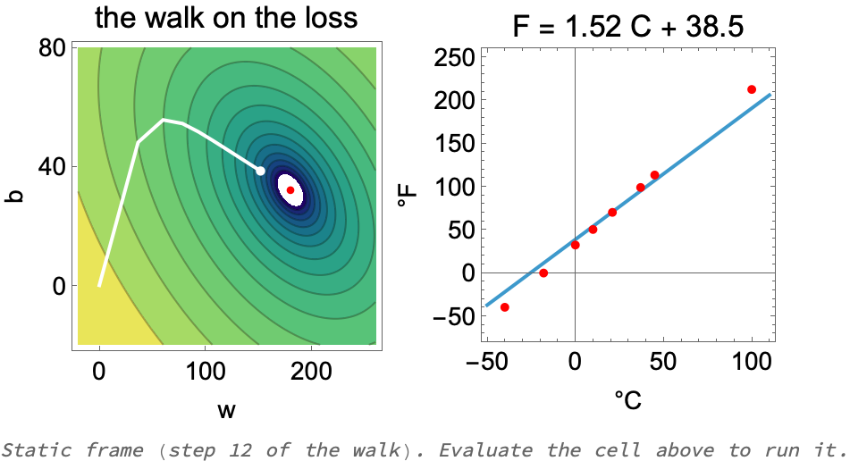

## 8. Balancing a stick on a moving cart

Balance a broom upright on the palm of your hand: you keep it up by moving your hand under it, a little ahead of where it falls. The cart-pole is the same problem on a rail: a stick of length 1 m (mass 0.1 kg) stands on a hinge on a cart (1 kg), and the only control is a horizontal force u on the cart, at most 10 N either way. The state is s = (x, v, θ, ω): cart position and speed, the angle of the stick from upright and its angular speed. Newton's laws give [7], with g = 9.81 m/s² and l = 0.5 m the half length of the stick,

```math
\begin{gathered}\frac{d \omega}{d t} = \frac{g \  \sin  \  \theta - \cos  \  \theta \  f}{l \  ( \frac{4}{3} - \frac{{m}_{p} \  {\cos }^{2} \  \theta}{{m}_{c} + {m}_{p}} )} , \frac{d \theta}{d t} = \omega \\ f = \frac{u + {m}_{p} \  l \  {\omega}^{2} \  \sin  \  \theta}{{m}_{c} + {m}_{p}} , \frac{d v}{d t} = f - \frac{{m}_{p} \  l \  \frac{d \omega}{d t} \  \cos  \  \theta}{{m}_{c} + {m}_{p}} , \frac{d x}{d t} = v\end{gathered} \quad  \tag{16}
```

Upright is an equilibrium, but an unstable one: left alone, a 17° tilt becomes a fallen stick in under a second. It is a classic test of control and of learning, because the controller must act continuously and every mistake grows.

### A teacher and a student

Control theory gives a good balancing rule. Near upright the equations are nearly linear, and for linear equations the LQR (linear quadratic regulator) finds the gains K of the best linear rule u = -K·s; LQRegulatorGains computes them. A real motor has a limited force, so the teacher saturates smoothly at 10 N:

```math
u = {u}_{\max } \  \tanh  ( - \frac{K \cdot s}{{u}_{\max }} ) , s = ( x , v , \theta , \omega ) , {u}_{\max } = 10 \  N \quad  \tag{17}
```

The teacher is a nonlinear function of four inputs, exactly the kind of function a network with one hidden layer can learn (Theorem 2). The student is a 4-8-1 network with σ hidden neurons and a linear output, trained with the squared error on 3000 random states, each labelled with the force the teacher would apply. This is called imitation learning; Widrow and Smith [8] trained an early network to balance a broom this way in 1964.

*Table 10. Four of the 3000 training examples, and the LQR gains of the teacher.*

```wolfram
(*c.18*)
(* the cart-pole: a stick of length 1 m on a cart that can be pushed
   left or right. State s = {x, v, θ, ω}: cart position and speed,
   stick angle from upright and its angular speed *)
{g0, mc, mp, len} = {9.81, 1., 0.1, 0.5};  (* len = half stick length *)
rhs[{x_, v_, th_, om_}, u_] := Module[{s = Sin[th], c = Cos[th], f, al},
   f = (u + mp len om^2 s)/(mc + mp);
   al = (g0 s - c f)/(len (4/3 - mp c^2/(mc + mp)));
   {v, f - mp len al c/(mc + mp), om, al}];
(* the teacher: an LQR controller for the straightened (linear)
   equations, with the motor limited to |u| <= 10 N *)
jac = D[rhs[{x, v, th, om}, u], {{x, v, th, om, u}}] /.
   Thread[{x, v, th, om, u} -> 0];
K = First@LQRegulatorGains[StateSpaceModel[{jac[[All, 1 ;; 4]],
      jac[[All, {5}]]}], {DiagonalMatrix[{1, 1, 10, 1}], {{0.1}}}];
umax = 10.;
teacher[s_] := umax Tanh[-K . s/umax];
(* 3000 random states as examples; inputs and targets scaled to ~1 *)
scale = {1., 2., 0.5, 2.};
SeedRandom[3];
states = RandomReal[{-1, 1}, {3000, 4}] . DiagonalMatrix[scale];
cpX = (#/scale) & /@ states;
cpY = List /@ (teacher /@ states/umax);
table[Join[{{"state {x, v, θ, ω}", "teacher force u (N)"}},
   Table[{NumberForm[states[[k]], 2], NumberForm[teacher[states[[k]]],
      3]}, {k, 4}], {{"LQR gains K", NumberForm[K, 3]}}], "Table 10"]
```

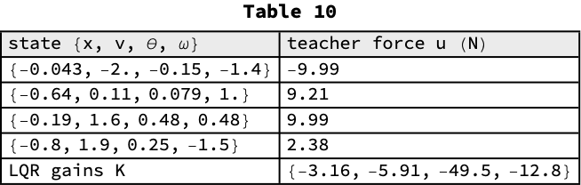

The network is never shown a moving cart: it only learns a function from states to forces. The test is to put it in control. The cart starts at rest with the stick tilted 17°, and the equations (16) are integrated with the Runge-Kutta method, step 0.02 s, with the force chosen by the network at every step.

*Table 11. The loss during training, and what happens when the network at that epoch drives the cart. Each epoch it holds the stick a little longer, and from about epoch 100 it balances.*

```wolfram
(*c.19*)
(* a 4-8-1 network imitates the teacher: σ hidden layer, linear
   output, squared error ("lin"). Then the network alone drives the
   cart and we see whether the stick stays up *)
SeedRandom[5];
histC = train[initNet[{4, 8, 1}], cpX, cpY, "lin", 0.5, 4000, 10];
ctrl[net_][s_] := Clip[umax First@First@Last@forward[net, {s/scale},
       Identity], {-umax, umax}];
dt = 0.02;
rk4[f_][s_] := Module[{u = f[s], k1, k2, k3, k4},
   k1 = rhs[s, u]; k2 = rhs[s + dt/2 k1, u];
   k3 = rhs[s + dt/2 k2, u]; k4 = rhs[s + dt k3, u];
   s + dt/6 (k1 + 2 k2 + 2 k3 + k4)];
fallen[s_] := Abs[s[[3]]] > Pi/2;
(* 6 s of motion from a 17° tilt; a fallen stick stays fallen *)
s0 = {0., 0., 0.3, 0.};
sim[f_, s1_, n_] := NestList[If[fallen[#], #, rk4[f][#]] &, s1, n];
fate[tr_] := With[{p = FirstPosition[fallen /@ tr, True]},
   If[MissingQ[p], "balances", Row[{"falls at t = ",
      NumberForm[dt (p[[1]] - 1), 2], " s"}]]];
table[Prepend[Table[With[{h = histC[[k]]}, {h[[1]],
      NumberForm[h[[2]], 3], fate@sim[ctrl[h[[3]]], s0, 300]}],
    {k, {1, 3, 5, 11, 21, 101, Length[histC]}}],
  {"epoch", "loss", "the stick, network in control"}], "Table 11"]
```

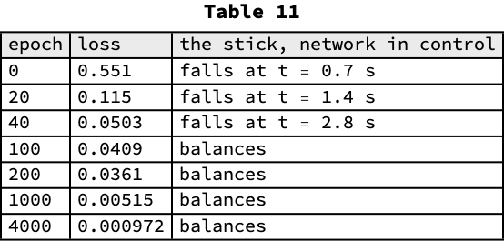

*Diagram 4. The trained balancing network. The thickest lines leave θ and ω: the tilt of the stick and how fast it is falling matter most, as for a person balancing a broom.*

```wolfram
(*c.19b*)
(* the trained balancing network: the four state variables in, the
   force out *)
figure[{{netDiagram[{4, 8, 1}, histC[[-1, 3]], {"x", "v", "θ", "ω"},
     {"force u"}, "Σ", ""]}},
 "Diagram 4. The 4-8-1 cart-pole controller after training"]
```

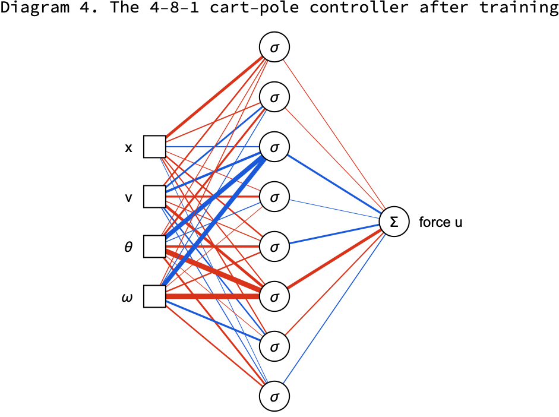

One decision of the controller, written out: the hidden layer multiplies the 8 × 4 matrix W by the scaled state, adds the 8 biases and applies σ; the output layer multiplies the 1 × 8 row W by these 8 values. The network's force is within 0.01 N of the teacher's.

*Table 11b. The trained controller as matrix products, for the start state of Table 11 (stick tilted 17°).*

```wolfram
(*c.19c*)
(* one decision of the trained controller, in matrices: the start
   state of Table 11, tilted 17°. W1 is 8×4 (8 hidden neurons × 4
   inputs), W2 is 1×8 *)
{{W1c, b1c}, {W2c, b2c}} = histC[[-1, 3]];
sIn = s0/scale;                       (* scaled input, 4×1 *)
z1c = W1c . sIn + b1c; h1c = LogisticSigmoid[z1c];
z2c = W2c . h1c + b2c;
mtable[{
   {"scaled state s/scale = (x, v, θ, ω)/(1, 2, 0.5, 2)", col[sIn]},
   {"hidden layer:  z = W s + b", Row[{mat[W1c], " ", col[sIn], " + ",
      col[b1c], " = ", col[z1c]}]},
   {"h = σ(z)", Row[{"σ", col[z1c], " = ", col[h1c]}]},
   {"output layer:  W h + b", Row[{mat[W2c], " ", col[h1c], " + ",
      col[b2c], " = ", col[z2c]}]},
   {"force u = 10 × output", Row[{NumberForm[10 First[z2c], 3],
      " N   (the teacher would push ", NumberForm[teacher[s0], 3],
      " N)"}]}},
 "Table 11b. One decision of the controller as matrix products"]
```

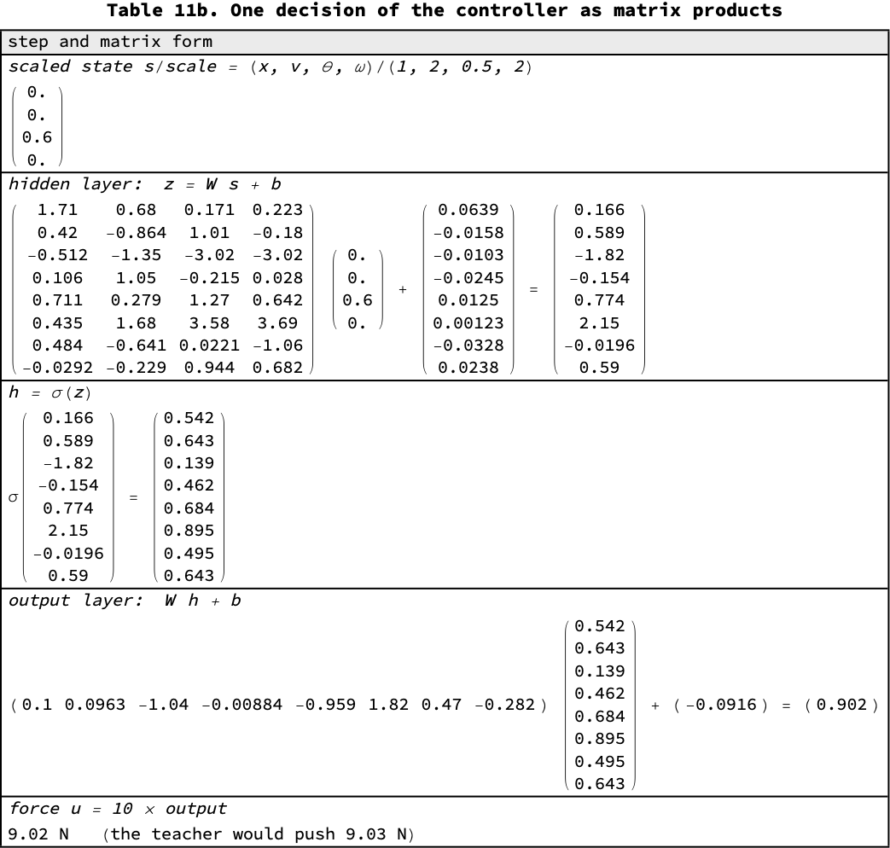

*Figure 7. Pick a training snapshot with the top slider and press play on time. Top: the cart, the stick and the force (blue arrow). Bottom: the angle of the stick over 6 s; 90° means it has fallen. The first snapshots drop the stick, later ones catch it, and the trained network brings it upright and the cart back towards the centre.*

```wolfram
(*c.20*)
(* watch it learn: pick a training snapshot, then press play on time *)
pick = Join[Range[1, 21], {26, 31, 41, 61, 101, 201, Length[histC]}];
(* 6 s of motion for each chosen snapshot, and its forces *)
trajC = Table[sim[ctrl[histC[[k, 3]]], s0, 300], {k, pick}];
forceC = Table[If[fallen[#], 0., ctrl[histC[[pick[[j]], 3]]][#]] & /@
    trajC[[j]], {j, Length[pick]}];
(* draw rail, cart, stick (length 2 len) and force arrow *)
cartPole[{x_, v_, th_, om_}, u_] := Graphics[{
    Gray, Line[{{-3, 0}, {3, 0}}],
    GrayLevel[0.3], Rectangle[{x - 0.25, 0.02}, {x + 0.25, 0.22}],
    Black, Disk[{x - 0.15, 0.02}, 0.04], Disk[{x + 0.15, 0.02}, 0.04],
    RGBColor[0.8, 0.3, 0.1], Thickness[0.012],
    Line[{{x, 0.22}, {x, 0.22} + 2 len {Sin[th], Cos[th]}}],
    Blue, Thickness[0.006], Arrowheads[0.04],
    If[Abs[u] > 0.2, Arrow[{{x, 0.12}, {x + 0.08 u, 0.12}}], {}]},
   PlotRange -> {{-3, 3}, {-0.3, 1.4}}, Frame -> True,
   FrameTicks -> {{None, None}, {{-2, 0, 2}, None}},
   FrameLabel -> {"x (m)", None}, ImageSize -> wFull];
(* one frame: the cart at time step n, and the angle θ(t) *)
cpView[j_, n_] := Column[{
   Show[cartPole[trajC[[j, n]], forceC[[j, n]]], PlotLabel -> Row[{
       "epoch ", histC[[pick[[j]], 1]], ",  t = ",
       NumberForm[dt (n - 1), {2, 2}], " s",
       If[fallen[trajC[[j, n]]], "   fell", ""]}],
     LabelStyle -> figStyle],
   ListLinePlot[{180/Pi trajC[[j, All, 3]]}, DataRange -> {0, 6},
    PlotRange -> {{0, 6}, {-95, 95}}, Frame -> True,
    FrameLabel -> {"t (s)", "θ (degrees)"}, AspectRatio -> 1/4,
    Epilog -> {Red, PointSize[0.02], Point[{dt (n - 1),
        180/Pi trajC[[j, n, 3]]}]},
    LabelStyle -> figStyle, ImageSize -> wFull]}];
Manipulate[cpView[j, n],
 {{j, 1, "training snapshot"}, 1, Length[pick], 1,
  Appearance -> "Labeled"},
 {{n, 1, "time"}, 1, 301, 1, ControlType -> Animator,
  AnimationRate -> 25, AnimationRunning -> False},
 SaveDefinitions -> True]
```

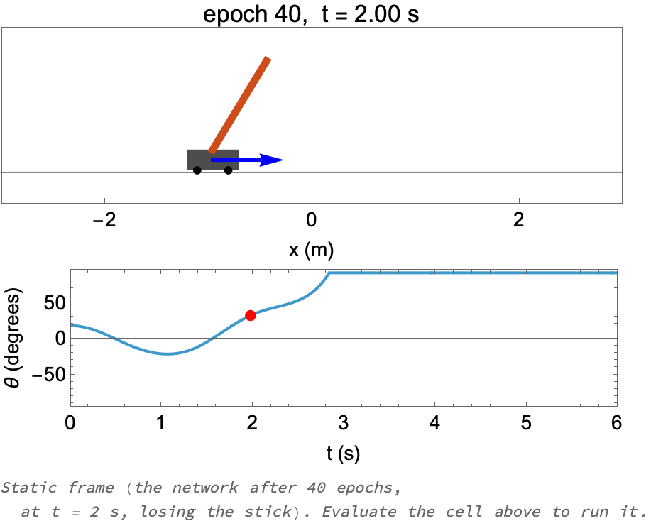

▶ **Video:** [CartPole-learning.mp4](videos/CartPole-learning.mp4), the cart-pole at four stages of training.

A controller is only useful if it copes with the unexpected. The trained network is started almost upright, and the stick is hit twice, at t = 1.5 s and at t = 4 s, as if flicked with a finger. Nothing like this was in the training data, yet the network runs the cart under the stick and recovers each time.

*Figure 8. The trained network against two pushes. Press play.*

```wolfram
(*c.21*)
(* the trained network against pushes it never saw in training: at
   t = 1.5 s and t = 4 s the stick is hit (ω jumps by ±2 rad/s) *)
netC = histC[[-1, 3]];
(* the pushes: ω changes by +2 rad/s at step 75, -2 at step 200 *)
push[k_][s_] := s + Which[k == 75, {0, 0, 0, 2.}, k == 200,
    {0, 0, 0, -2.}, True, 0];
(* each step: the network chooses u, Runge-Kutta moves the
   cart-pole by dt, then a push may hit *)
trajP = FoldList[push[#2][rk4[ctrl[netC]][#1]] &, {0., 0., 0.05, 0.},
   Range[350]];
pushFrames = Table[Show[cartPole[trajP[[n]], ctrl[netC][trajP[[n]]]],
    PlotLabel -> Row[{"t = ", NumberForm[dt (n - 1), {2, 2}], " s",
       If[75 <= n <= 85 || 200 <= n <= 210, "   push!", ""]}],
    LabelStyle -> figStyle], {n, 1, 351, 2}];
ListAnimate[pushFrames, AnimationRate -> 25,
 AnimationRepetitions -> Infinity,
 AnimationRunning -> False]  (* starts only when play is pressed *)
```

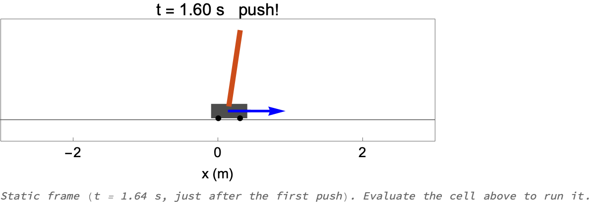

▶ **Video:** [CartPole-push-test.mp4](videos/CartPole-push-test.mp4), the push test of Figure 8.

## 9. A network learns the physics of a pendulum

The cart-pole network learned what to do. A network can also learn how a system behaves: a model of its dynamics, which can then be run forward in time like a simulator. Take a pendulum of length 1 m, with time measured so that g/l = 1. Its angle obeys θ″ = a(θ), and we pretend not to know the force law a(θ) = -sin θ: we only have 200 measurements of angle and acceleration, with a little noise. A 1-6-1 network learns a(θ) from them, and the learned pendulum is then run by itself:

```math
\begin{gathered}\frac{d \theta}{d t} = \omega , \frac{d \omega}{d t} = a ( \theta ) \\ E = \frac{{\omega}^{2}}{2} + V ( \theta ) , {V}^{\prime} ( \theta ) = - a ( \theta ) \quad  \implies \quad  \frac{d E}{d t} = \omega \  ( a ( \theta ) + {V}^{\prime} ( \theta ) ) = 0\end{gathered} \quad  \tag{18}
```

**Theorem 4 (a learned force law conserves energy).** If the model of the acceleration depends on the angle only, θ″ = a(θ) with any continuous a, then E = ω²/2 + V(θ), with V any antiderivative of -a, stays constant along every motion. In particular the learned pendulum can never run down or speed up.

**Proof.** Along a motion, dE/dt = ω ω′ + V′(θ) θ′ = ω a(θ) - a(θ) ω = 0, because θ′ = ω and ω′ = a(θ), as written in the second line of Eq. (18). ∎

This is a lesson about building models: the right inputs give the right structure. A network fed (θ, ω) could learn a small fake friction or push and slowly drift away; one fed θ alone cannot, whatever its weights. To keep this property in the computer, the motion is integrated with the leapfrog (velocity Verlet) method [9], which nearly conserves energy over very long times, with step 0.05 s.

The network is trained with Adam, a refinement of gradient descent (Kingma and Ba [10]) that keeps a running average m of each gradient entry g and a running average v of its square, and divides the step by the square root of v; the hats correct the averages for their start at 0, k being the step number. Every weight then gets its own step size; the gradients still come from backpropagation, Theorem 3:

```math
\begin{gathered}m \leftarrow {\beta}_{1} \  m + ( 1 - {\beta}_{1} ) \  g , v \leftarrow {\beta}_{2} \  v + ( 1 - {\beta}_{2} ) \  {g}^{2} \\ W \leftarrow W - \eta \  \frac{}{\sqrt{} + \epsilon} ,  = \frac{m}{1 - {{\beta}_{1}}^{k}} ,  = \frac{v}{1 - {{\beta}_{2}}^{k}}\end{gathered} \quad  \tag{19}
```

The pendulum is released at 115°, far beyond the small-angle range. There the true period, 8.35 s, is a third longer than the 2π = 6.28 s of the textbook law a = -θ (Hooke's law), so learning the curve, not a straight line, is what gets the swing right.

*Table 12. The period of the learned pendulum during training. The untrained model sends the pendulum over the top; then the period approaches the true value, which the linear law misses by 2 s.*

```wolfram
(*c.22*)
(* a pendulum, θ'' = a(θ), whose force law a(θ) = -sin θ we pretend not
   to know: we only have 200 noisy measurements of angle and
   acceleration. A 1-6-1 network learns a(θ) *)
SeedRandom[11];
thD = RandomReal[{-2.6, 2.6}, 200];
aD = -Sin[thD] + RandomReal[NormalDistribution[0, 0.02], 200];
(* Adam (Kingma and Ba): gradient descent with a running average of
   the gradient (m) and of its square (v), so each weight gets its own
   step size. The gradients still come from backprop of c.9 *)
trainAdam[net0_, X_, Y_, kind_, eta_, epochs_, every_] := Module[
   {net = net0, m = 0 net0, v = 0 net0, l, g, hist = {},
    b1 = 0.9, b2 = 0.999},
   Do[{l, g} = backprop[net, X, Y, kind];
    If[Mod[e - 1, every] == 0, AppendTo[hist, {e - 1, l, net}]];
    m = b1 m + (1 - b1) g; v = b2 v + (1 - b2) g^2;
    net = net - eta (m/(1 - b1^e))/(Sqrt[v/(1 - b2^e)] + 10.^-8),
    {e, epochs}];
   AppendTo[hist, {epochs, First@backprop[net, X, Y, kind], net}]];
SeedRandom[1];
histP = trainAdam[initNet[{1, 6, 1}], List /@ (thD/2), List /@ aD,
   "lin", 0.03, 2000, 10];
accel[net_][th_] := First@First@Last@forward[net, {{th/2}}, Identity];
(* run the model: the leapfrog (velocity Verlet) step, 0.05 s *)
h = 0.05;
leap[a_][{th_, om_}] := Module[{o = om + h/2 a[th], t},
   t = th + h o; {t, o + h/2 a[t]}];
p0 = {2., 0.};                      (* released at 115° *)
period[tr_] := With[{z = Flatten@Position[Partition[
        Sign[tr[[All, 1]]], 2, 1], {1, -1}]},
   If[Length[z] > 1, NumberForm[h Mean@Differences[z], 3],
    "goes over the top"]];
truthP = NestList[leap[-Sin[#] &], p0, 800];
table[Join[{{"model of the force", "loss", "period (s)"}},
   Table[{Row[{"network, epoch ", histP[[k, 1]]}],
     NumberForm[histP[[k, 2]], 3],
     period@NestList[leap[accel[histP[[k, 3]]]], p0, 800]},
    {k, {1, 3, 6, 11, 51, Length[histP]}}],
   {{"Hooke's law a = -θ", "", period@NestList[leap[-# &], p0, 800]},
    {"true pendulum a = -sin θ", "", period[truthP]}}], "Table 12"]
```

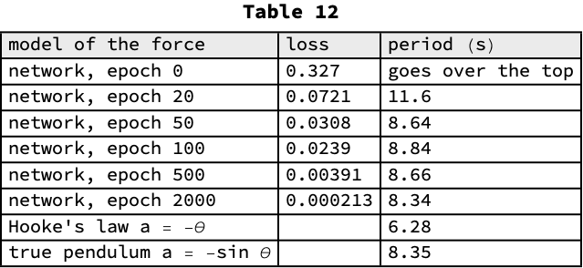

*Diagram 5. The trained pendulum model, angle in and acceleration out. Six σ neurons, added up, make the curve -sin θ of Figure 9.*

```wolfram
(*c.22b*)
(* the trained force-law network: angle in, acceleration out *)
figure[{{netDiagram[{1, 6, 1}, histP[[-1, 3]], {"θ"}, {"a(θ)"}, "Σ",
     ""]}}, "Diagram 5. The 1-6-1 pendulum model after training"]
```

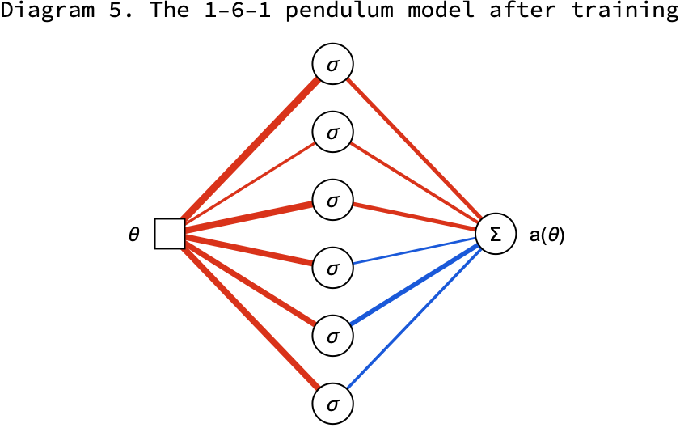

*Table 12b. The trained pendulum model as matrix products at θ = 1: a 6 × 1 column of weights, then a 1 × 6 row. The result is within 0.01 of -sin 1.*

```wolfram
(*c.22c*)
(* the trained pendulum model in matrices, at θ = 1: W1 is 6×1,
   W2 is 1×6 *)
{{W1p, b1p}, {W2p, b2p}} = histP[[-1, 3]];
z1p = W1p . {1/2.} + b1p; h1p = LogisticSigmoid[z1p];
z2p = W2p . h1p + b2p;
mtable[{
   {"hidden layer:  z = W (θ/2) + b", Row[{mat[W1p], " ", col[{0.5}],
      " + ", col[b1p], " = ", col[z1p]}]},
   {"h = σ(z)", Row[{"σ", col[z1p], " = ", col[h1p]}]},
   {"output layer:  a = W h + b", Row[{mat[W2p], " ", col[h1p], " + ",
      col[b2p], " = ", col[z2p]}]},
   {"compare with the true force law", Row[{"a(1) = ",
      NumberForm[First[z2p], 4], ",   -sin 1 = ",
      NumberForm[-Sin[1.], 4]}]}},
 "Table 12b. The pendulum model as matrix products"]
```

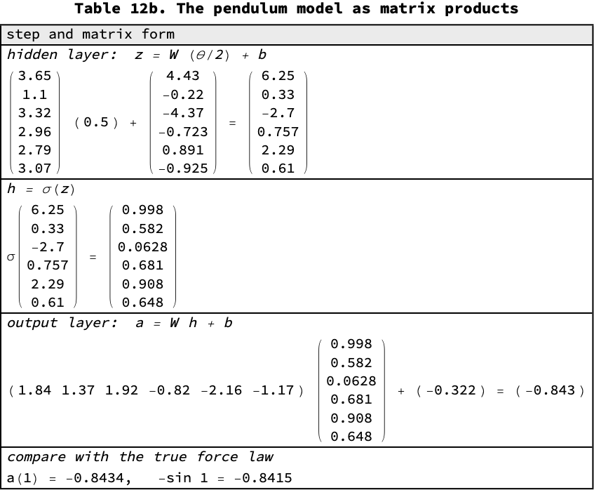

*Figure 9. Pick a training snapshot and press play on time. Top left: the learned pendulum (orange) beside the true one (gray). Top right: the learned force law against the measurements and -sin θ. Bottom: the angle over 40 s; early models fall out of step, the trained one stays in step with the true pendulum.*

```wolfram
(*c.23*)
(* the learned pendulum (orange) beside the real one (gray): pick a
   training snapshot, then press play on time *)
pickP = Join[Range[1, 21], {26, 31, 41, 61, 101, 151, Length[histP]}];
trajL = Table[NestList[leap[accel[histP[[k, 3]]]], p0, 800], {k, pickP}];
bob[th_, col_] := {col, Thickness[0.008], Line[{{0, 0},
     {Sin[th], -Cos[th]}}], Disk[{Sin[th], -Cos[th]}, 0.09]};
pendView[j_, n_] := Grid[{{
    Graphics[{bob[truthP[[n, 1]], GrayLevel[0.75]],
      bob[trajL[[j, n, 1]], RGBColor[0.9, 0.45, 0.1]], Black,
      Disk[{0, 0}, 0.03]}, PlotRange -> {{-1.2, 1.2}, {-1.2, 1.2}},
     PlotLabel -> Row[{"epoch ", histP[[pickP[[j]], 1]]}],
     LabelStyle -> figStyle, ImageSize -> wHalf],
    Plot[{-Sin[t], accel[histP[[pickP[[j]], 3]]][t]}, {t, -3, 3},
     PlotStyle -> {GrayLevel[0.7], RGBColor[0.9, 0.45, 0.1]},
     PlotRange -> {-1.6, 1.6}, Frame -> True,
     FrameLabel -> {"θ", "a(θ)"}, AspectRatio -> 1,
     Epilog -> {Gray, PointSize[0.012], Point[Transpose[{thD, aD}]]},
     PlotLabel -> "learned force law", LabelStyle -> figStyle,
     ImageSize -> wHalf]},
   {ListLinePlot[{truthP[[All, 1]], trajL[[j, All, 1]]},
     DataRange -> {0, 40}, PlotRange -> {{0, 40}, {-3.5, 3.5}},
     PlotStyle -> {GrayLevel[0.75], RGBColor[0.9, 0.45, 0.1]},
     Frame -> True, FrameLabel -> {"t (s)", "θ"}, AspectRatio -> 1/4,
     Epilog -> {Red, PointSize[0.02], Point[{h (n - 1),
         trajL[[j, n, 1]]}]}, LabelStyle -> figStyle,
     ImageSize -> wFull], SpanFromLeft}}];
Manipulate[pendView[j, n],
 {{j, 1, "training snapshot"}, 1, Length[pickP], 1,
  Appearance -> "Labeled"},
 {{n, 1, "time"}, 1, 801, 1, ControlType -> Animator,
  AnimationRate -> 20, AnimationRunning -> False},
 SaveDefinitions -> True]
```

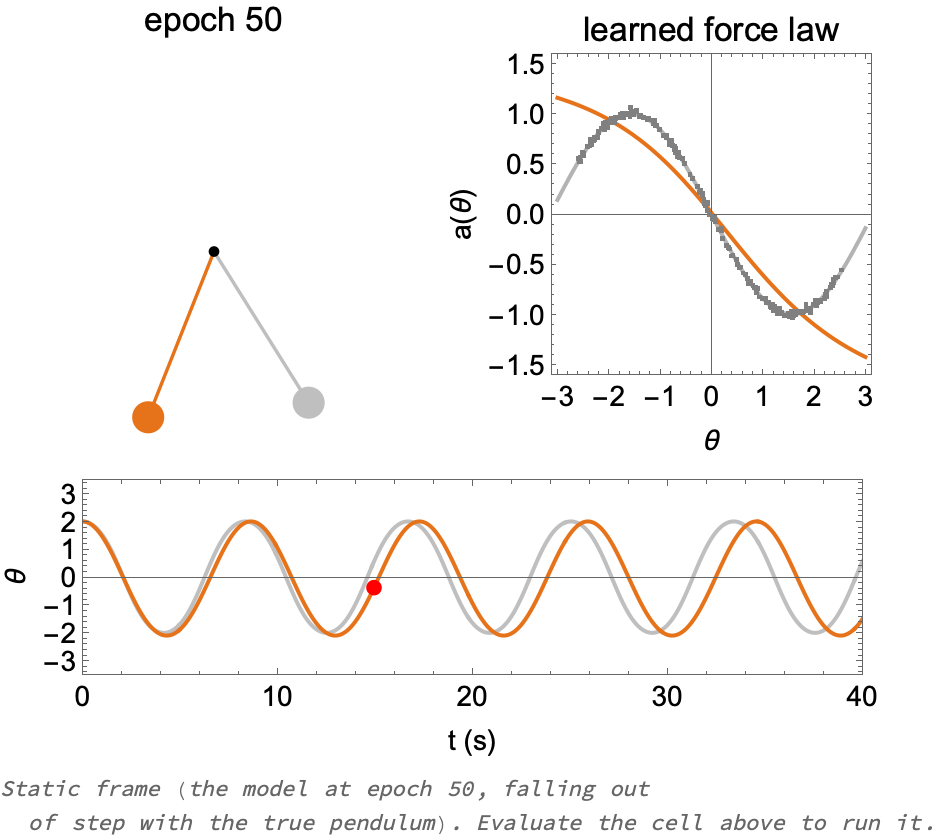

▶ **Video:** [Pendulum-learning.mp4](videos/Pendulum-learning.mp4), learned pendulums at four stages of training.

▶ **Unity 6 version in 3D:** the cart-pole and the learned pendulum with these trained networks, [in 4K on YouTube](https://youtu.be/lIUtEO9m79M); project: [neural-networks-unity](https://github.com/lossofgenerality/neural-networks-unity).

## 10. The same with NetChain and NetTrain

Wolfram Language's neural network framework builds the same networks from layers. LinearLayer[m] is W x + b with m outputs, LogisticSigmoid is σ, and NetTrain does backpropagation and gradient descent, by default with Adam, Eq. (19).

*Table 13. The framework against our code on XOR and on the cart-pole. The numbers differ slightly because the starting weights and the optimizer differ, but both controllers balance the stick.*

```wolfram
(*c.24*)
(* the same networks with the built-in framework: LinearLayer is
   W x + b, LogisticSigmoid is σ *)
(* XOR: 2 inputs, 3 σ neurons, 1 σ output, as in Table 7 *)
xorChain = NetChain[{LinearLayer[3], LogisticSigmoid, LinearLayer[1],
    LogisticSigmoid}, "Input" -> 2];
xorTrained = NetTrain[xorChain, xorX -> xorT, LossFunction ->
    MeanSquaredLossLayer[], MaxTrainingRounds -> 2000,
   Method -> {"ADAM", "LearningRate" -> 0.05}, RandomSeeding -> 1,
   TrainingProgressReporting -> None];
(* cart-pole: 4 inputs, 8 σ neurons, linear output *)
cpChain = NetChain[{LinearLayer[8], LogisticSigmoid, LinearLayer[1]},
   "Input" -> 4];
cpTrained = NetTrain[cpChain, cpX -> cpY, LossFunction ->
    MeanSquaredLossLayer[], MaxTrainingRounds -> 300,
   RandomSeeding -> 1, TrainingProgressReporting -> None];
(* the trained NetChain as a controller, same scaling as ctrl *)
ctrlChain[s_] := Clip[umax First@cpTrained[s/scale], {-umax, umax}];
table[{{"network", "result"},
  {"XOR, NetTrain", NumberForm[Flatten[xorTrained[xorX]], 3]},
  {"XOR, our backprop (Table 7)", NumberForm[Flatten@Last@forward[
      histX[[-1, 3]], xorX, sigma], 3]},
  {"cart-pole, NetTrain controller", fate@sim[ctrlChain, s0, 300]},
  {"cart-pole, our controller (Table 11)", fate@sim[ctrl[netC], s0,
     300]}}, "Table 13"]
```

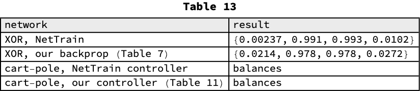

To see that nothing more is hidden inside the framework, take the trained weights out of the cart-pole NetChain and run them through forward of cell c.9.

*Table 14. The NetChain and our forward pass, with the same weights, agree to single precision.*

```wolfram
(*c.25*)
(* the framework does exactly our algebra: take the weights out of the
   trained NetChain and run them through forward of c.9 *)
netFromChain = Table[{Normal@NetExtract[cpTrained, {i, "Weights"}],
    Normal@NetExtract[cpTrained, {i, "Biases"}]}, {i, {1, 3}}];
(* the force for all 3000 states, by the NetChain and by us *)
uChain = Flatten[cpTrained[cpX]];
uOurs = Flatten@Last@forward[netFromChain, cpX, Identity];
table[{{"quantity", "value"},
  {"shapes of W, b in the NetChain",
   Dimensions /@ Flatten[netFromChain, 1]},
  {"max |NetChain output - forward of c.9|",
   sci@Max@Abs[uChain - uOurs]}}, "Table 14"]
```

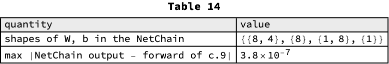

## Appendix A. The formulas in one place

- One neuron: z = w·x + b, a = σ(z), Eqs. (1)–(2); σ′ = σ(1 - σ), Eq. (3).
- A layer: z = W x + b with W of size m × n (outputs × inputs), Eq. (4); for M samples as rows, Z = X $`{W}^{T}`$ + b, Eq. (5).
- A network: $`{a}^{0}`$ = x; $`{z}^{l}`$ is $`{W}^{l}`$ times the activations of the previous layer, plus $`{b}^{l}`$; $`{a}^{l}`$ = σ($`{z}^{l}`$), Eq. (6).
- Losses: squared error, Eq. (8); softmax and cross-entropy, Eqs. (9)–(10).
- Backpropagation: $`{\delta}^{L}`$ from Eq. (11), $`{\delta}^{l}`$ from Eq. (12), gradients from Eq. (13); the gradient of $`{W}^{l}`$ has the shape of $`{W}^{l}`$.
- Training: $`{W}^{l}`$ ← $`{W}^{l}`$ - η ∂L/∂$`{W}^{l}`$, Eq. (14); one epoch is one pass over the data; Adam, Eq. (19), adapts the step for each weight.
- Learning dynamics: a network can learn what to do (a controller, Section 8) or how a system moves (a model, Section 9); a model of the force that depends on the position alone conserves energy, Theorem 4.
- Shapes in the code: X is M × n, every $`{A}^{l}`$ is M × (neurons of layer l), every δ is M × (neurons of its layer), and ∂L/∂$`{W}^{l}`$ is $`{\delta}^{T}`$ A of the previous layer.

## Appendix B. Saving the animations as videos

Every animation in this notebook is a list of frames, and Export turns a list of frames into a video. Cells c.0.4, c.14, c.20, c.21 and c.23 keep their frames, or a function that draws frame k, under a name: stepView, xorFrames, cpView, pushFrames and pendView. Cell c.26 exports five MP4 files into the folder of the notebook: the 13 steps of Figure 0.1, the XOR training of Figure 5, the push test of Figure 8, the cart-pole at four stages of training (Figure 7) and the trained pendulum model (Figure 9). It needs the whole notebook to have been run first, and drawing several hundred frames takes a few minutes; videos can be switched off one by one in doExport.

The same idea works for any Manipulate: write its body as a function of the control variables, as in c.20 and c.23, then Export a Table of that function over the values to be shown.

*Table 15. The exported videos and their sizes.*

```wolfram
(*c.26*)
(* save the animations as MP4 videos in the notebook's folder. Run the
   notebook first (c.0 to c.25). Export draws every frame, so this
   takes a few minutes; set doExport to False to skip a video *)
dir = If[StringQ[Quiet@NotebookDirectory[]], NotebookDirectory[],
   $HomeDirectory];
video[name_, frames_, fps_] := Export[FileNameJoin[{dir, name}],
   frames, "MP4", "FrameRate" -> fps];
doExport = <|"steps" -> True, "xor" -> True, "push" -> True,
   "balance" -> True, "pendulum" -> True|>;
files = DeleteCases[{
   If[doExport["steps"], video["Tiny-network-13-steps.mp4",
     Table[stepView[k], {k, Length[allSteps]}], 1]],
   If[doExport["xor"], video["XOR-training.mp4", xorFrames, 8]],
   If[doExport["push"], video["CartPole-push-test.mp4", pushFrames,
     25]],
   (* Figure 7 at four training snapshots, 6 s each *)
   If[doExport["balance"], video["CartPole-learning.mp4", Flatten@Table[
       cpView[j, n], {j, {1, 3, 5, Length[pick]}}, {n, 1, 301, 3}],
     17]],
   (* Figure 9 for the trained model: 40 time units *)
   If[doExport["pendulum"], video["Pendulum-learned.mp4",
     Table[pendView[Length[pickP], n], {n, 1, 801, 4}], 20]]},
  Null];
table[Prepend[{FileNameTake[#], Round[FileByteCount[#]/1024.], " kB"} & /@
    files, {"video", "size", ""}], "Table 15. The exported videos"]
```

**Output:** not run for this edition. The five videos it makes are in [`videos/`](videos).

## References

- [1] D. O Shayda, N. Hoshino, S Shape Functions Theory, Computational Classnotes (2026).
- [2] M. Minsky, S. Papert, Perceptrons, MIT Press (1969): the XOR limitation of a single layer.
- [3] G. Cybenko, Approximation by superpositions of a sigmoidal function, Math. Control Signals Systems 2 (1989) 303–314. doi:10.1007/BF02551274
- [4] D. E. Rumelhart, G. E. Hinton, R. J. Williams, Learning representations by back-propagating errors, Nature 323 (1986) 533–536. doi:10.1038/323533a0
- [5] M. A. Nielsen, Neural Networks and Deep Learning, Determination Press (2015), neuralnetworksanddeeplearning.com
- [6] I. Goodfellow, Y. Bengio, A. Courville, Deep Learning, MIT Press (2016), deeplearningbook.org
- [7] A. G. Barto, R. S. Sutton, C. W. Anderson, Neuronlike adaptive elements that can solve difficult learning control problems, IEEE Trans. Systems, Man, and Cybernetics 13 (1983) 834–846: the cart-pole equations and parameters used here.
- [8] B. Widrow, F. W. Smith, Pattern-recognizing control systems, in Computer and Information Sciences (COINS) Symposium Proceedings, Spartan Books (1964) 288–317: a network taught to balance a broom by imitation.
- [9] E. Hairer, C. Lubich, G. Wanner, Geometric numerical integration illustrated by the Störmer–Verlet method, Acta Numerica 12 (2003) 399–450: why leapfrog keeps the energy.
- [10] D. P. Kingma, J. Ba, Adam: A method for stochastic optimization, ICLR 2015, arXiv:1412.6980.

© Computational Classnotes · CC BY-NC-SA 4.0
